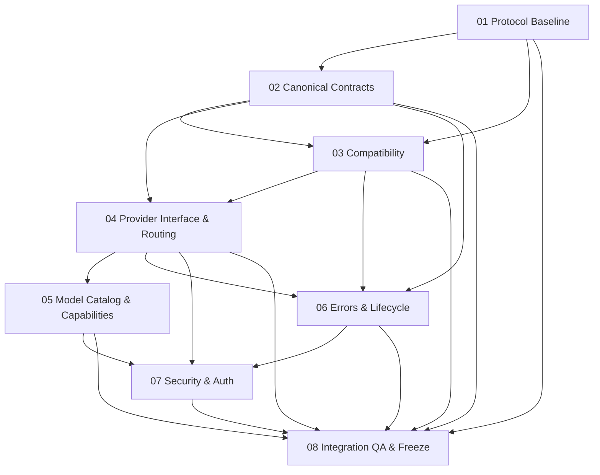

# Wave 01 — Protocol & Architecture

## Wave Goal

Freeze an evidence-backed Comic Translate protocol and a coherent provider-independent
architecture before implementation. This README controls orchestration; the actual
work is distributed across eight independently executable tasks, all **PLANNED**.

The intended flow is:

```text
Comic Translate → OpenAI-compatible HTTP API → Compatibility Layer
→ CanonicalRequest → Provider Router → Provider → InferenceResult
→ Compatibility Layer → OpenAI-compatible response → Comic Translate
```

## Repository Baseline and Required Reading

At task-set creation, the repository contains six instruction documents and four
custom agents; no existing tasks, architecture plans, ADRs, README, API/provider
notes, or Comic Translate source research were found. The source instructions
already fix major boundaries; this Wave validates and specifies them rather than
reopening them without cause. Reinspect at execution time and preserve new decisions.

Read [project.md](../../instructions/project.md) and its five mandatory specialized
references. Each task lists relevant sources and agent definitions. Existing
[Coordinator](../../agents/coordinator.agent.md),
[Architecture & Security](../../agents/architecture-security.agent.md),
[Implementation & Testing](../../agents/implementation-testing.agent.md), and
[Google / Antigravity](../../agents/google-antigravity.agent.md) configurations apply.

With no existing architecture documentation convention, the tasks propose
`docs/architecture/`. Those documents are **future execution deliverables**.
Creating this task set does not create them, freeze architecture, or mark work done.

## Non-Goals

Wave 01 does not implement FastAPI runtime endpoints, the OpenAI provider, OAuth
flows, Antigravity providers, provider subprocesses, production Pydantic models,
tests/fixture files, deployment/packaging, or Comic Translate modifications.
Do not install dependencies or use real credentials to validate designs.
No existing repository evidence places implementation in this Wave.

## Task Index

| ID | Task | Depends On | Primary Agent | Reviewer | Status |
| --- | --- | --- | --- | --- | --- |
| 01 | [Comic Translate Protocol Baseline](01-comic-translate-protocol-baseline.task.md) | None | Architecture & Security | Coordinator | COMPLETED |
| 02 | [Canonical Domain Contracts](02-canonical-domain-contracts.task.md) | 01 | Architecture & Security | Coordinator | COMPLETED |
| 03 | [Compatibility Layer Contract](03-compatibility-layer-contract.task.md) | 01, 02 | Architecture & Security | Implementation & Testing | PLANNED |
| 04 | [Provider Interface and Routing](04-provider-interface-and-routing.task.md) | 02, 03 | Architecture & Security | Coordinator | PLANNED |
| 05 | [Model Catalog and Capabilities](05-model-catalog-and-capabilities.task.md) | 04 | Architecture & Security | Google / Antigravity | PLANNED |
| 06 | [Error, Reliability and Request Lifecycle](06-error-reliability-and-request-lifecycle.task.md) | 02, 03, 04 | Architecture & Security | Implementation & Testing | PLANNED |
| 07 | [Security and Authentication Boundaries](07-security-and-auth-boundaries.task.md) | 04, 05, 06 | Architecture & Security | Coordinator | PLANNED |
| 08 | [Wave Integration QA and Architecture Freeze](08-wave-integration-qa-and-architecture-freeze.task.md) | 01, 02, 03, 04, 05, 06, 07 | Coordinator | Architecture & Security | PLANNED |

## Dependency Graph



The explicit task dependencies govern. Tasks 05 and 06 may proceed independently
after Task 04, unlike a strict 05 → 06 chain: catalog semantics are not a prerequisite
for defining the common error contract. The Coordinator reconciles shared availability
terms before Task 07, which requires both. Task 08 directly verifies all seven outputs.

Task 01 freezes the external consumer contract before Tasks 02–06 can finalize.
Task 02 defines canonical structures, including minimum capability/model shapes;
Task 05 owns detailed discovery and availability semantics. Refinements that alter
an accepted upstream contract reopen that task for impact review, not a circular
dependency or a silent downstream rewrite.

## Future Artifact Map

| Task | Future document (not created by task-set planning) |
| --- | --- |
| 01 | `docs/architecture/comic-translate-protocol-contract.md` |
| 02 | `docs/architecture/canonical-domain-contracts.md` |
| 03 | `docs/architecture/compatibility-contract.md` |
| 04 | `docs/architecture/provider-contract-and-routing.md` |
| 05 | `docs/architecture/model-catalog-and-capabilities.md` |
| 06 | `docs/architecture/error-and-request-lifecycle.md` |
| 07 | `docs/architecture/security-and-auth-boundaries.md` |
| 08 | `docs/architecture/wave-01-architecture-freeze.md` |

Each task's completion evidence belongs with its future deliverable and handoff;
do not create extra monolithic Wave task files. Link existing evidence and use
stable requirement/decision IDs so later reviews can trace every boundary.

## Wave Exit Criteria

- Comic Translate public protocol is documented from versioned source evidence.
- Public, canonical, and provider contracts are clearly separated.
- CanonicalRequest and InferenceResult are frozen with image preservation and no credentials.
- Provider contract, routing, and namespaced model strategy are frozen.
- Capability/model-catalog semantics and discovery ownership are frozen.
- Error taxonomy, lifecycle, and reliability ownership are frozen.
- Auth/security ownership is frozen, including 127.0.0.1 default binding.
- OpenAI Responses/SIWC and both Google SDK/agy CLI paths remain compatible.
- Codex CLI is only a development tool; private credential extraction and undocumented auth APIs remain prohibited.
- No provider implementation or Comic Translate modifications are introduced.
- Architecture & Security independent review passes; required findings are resolved.
- Task 08 gates pass and the Coordinator accepts final Wave QA.

## Execution Rules

Execute tasks in dependency order. Do not start a dependent task while its
architectural prerequisite contains unresolved blocking findings. Each task must
produce its own completion evidence. A task being complete does not imply the Wave
is complete. **Wave 01 completes only after Task 08 passes.**

The Coordinator owns orchestration and acceptance. Most design work belongs to
Architecture & Security. Implementation & Testing reviews testability and feasibility,
not production implementation. Google / Antigravity reviews Task 05 and participates
elsewhere only when Google-specific assumptions need validation. Use the smallest
appropriate set of agents.

For final independent review, assign Architecture & Security a fresh review context
that did not author the reviewed decisions; disclose author/reviewer roles and do not
count self-review as independent acceptance. If independent coverage is unavailable,
report that gate as blocked.

All tasks separate required decisions from intentionally deferred implementation
details. Deferrals need an owner, reason, and revisit trigger; unresolved core
contracts cannot be deferred to claim completion. Existing instruction conflicts
go to the Coordinator and block affected work rather than silently changing policy.

At execution start, inspect branch/working tree and preserve unrelated changes.
Only documentation is authorized by these Wave tasks. Do not modify instructions
or agents, create a branch, commit, or push without separate explicit authorization.
Review diffs, links, evidence, and scope; use hashes/content comparisons when Git is
unavailable, and inspect untracked files because ordinary Git diff omits them.
