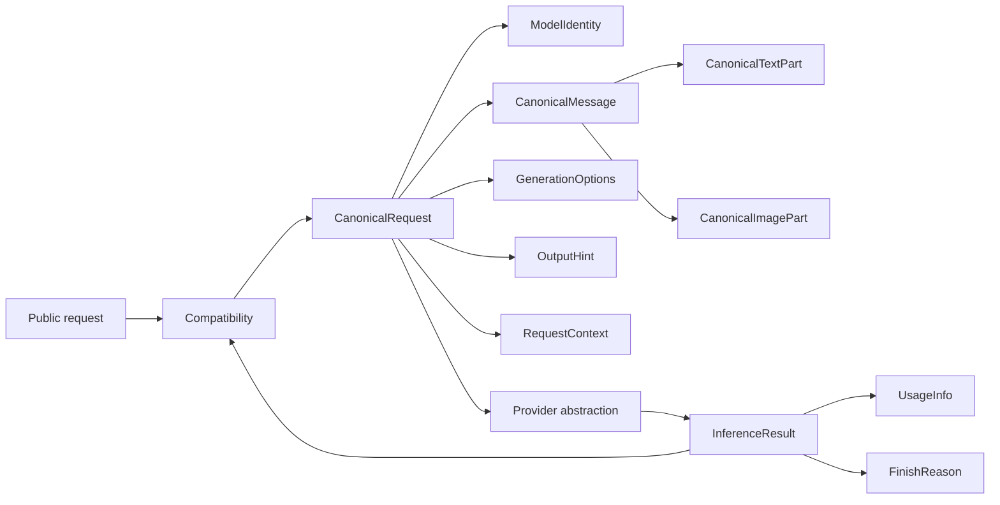

# Canonical Domain Contracts

## 1. Purpose

This document freezes the provider-independent internal vocabulary used between
the compatibility layer and provider adapters. It defines semantic contracts,
not production Python or Pydantic classes.

```text
Public Comic Translate request
        -> compatibility normalization
        -> CanonicalRequest
        -> provider router and selected provider
        -> InferenceResult
        -> compatibility response construction
        -> public Comic Translate response
```

The canonical domain is not an OpenAI Chat Completions or Responses schema, a
Google SDK schema, an `agy` event schema, or Comic Translate JSON with renamed
fields. Public parsing and provider conversion occur at opposite edges of the
domain.

Normative terms in this document are:

- **Frozen decision**: required by Task 02 and change-controlled by impact review.
- **Invariant**: must hold for every valid canonical value and conversion path.
- **Deferred decision**: assigned to a named owner and trigger.
- **Assumption**: a stated input that does not become a consumer fact.
- **Open question**: non-blocking uncertainty with a safe current outcome.

## 2. Inputs and Dependencies

The primary prerequisite is [Comic Translate Protocol Contract](comic-translate-protocol-contract.md),
accepted at SHA-256
`7f38d5fd91962d50209bc56e68e29c1c6ea44427003c84cada78e3bfd08b7523`.
Its consumer facts remain frozen.

Task 01 establishes that Comic Translate 2.8.9 uses its Custom translator to send
a complete, non-streaming `POST /v1/chat/completions` request containing a manual
model ID, ordered system/user content arrays, `temperature`,
`max_completion_tokens`, and optionally one JPEG data URI image. It consumes one
text value at `choices[0].message.content`, with application-level `block_N` JSON
semantics. Bearer authentication, HTTP routing, and the response envelope are
transport concerns.

Additional inputs are the project and MVP architecture, OpenAI SDK and Codex CLI
boundaries, Google SDK/CLI boundary, and Wave 01 Task 02 scope. Provider-specific
references constrain paper mappings but do not define canonical fields.

## 3. Design Principles

1. Canonical values express inference meaning, never wire format.
2. Public protocol names are translated once at the compatibility boundary.
3. Provider-specific objects and events exist only inside provider adapters.
4. Ordering is data: message order and content-part order are preserved.
5. Images are first-class; unsupported image requests fail explicitly.
6. Identity remains unambiguous before and after routing.
7. Missing evidence remains unknown, not a fabricated default.
8. Credentials and authentication/session state never enter inference domain data.
9. A result value represents completed success; failures use the error path.
10. Task 02 defines minimum capability/catalog structure without taking Task 05's
    discovery and availability ownership.

## 4. Domain Relationship Overview



Supporting value objects (`ModelIdentity`, `GenerationOptions`, `OutputHint`,
`RequestContext`, and model capability overrides) are part of the canonical
contract even though the ten task-named concepts remain its primary surface.

## 5. CanonicalRequest

`CanonicalRequest` is the complete provider-independent inference request and the
only request shape accepted by providers.

| Field | Conceptual type | Presence/default | Omission and null | Validation / owner / rationale |
| --- | --- | --- | --- | --- |
| `model` | `ModelIdentity` | Required; no default | Cannot be omitted or null | Compatibility parses the public identity; the router resolves it. Required by CT-REQ-007/018 and project routing policy. |
| `messages` | Ordered nonempty list of `CanonicalMessage` | Required; no default | Cannot be omitted or null | Compatibility owns normalization. Order is preserved; CT-REQ-008/011/012. |
| `generation` | `GenerationOptions` | Required container; members may be absent | Container cannot be null; absent members mean no canonical request for that option | Compatibility maps public semantics; providers map, filter, or reject options. CT-REQ-009/010. |
| `output_hint` | `OutputHint` | Optional; absent by default | Absence means no inferred output-shape intent; null is invalid | Compatibility/application semantics may derive it. It is not a public `response_format`. CT-REQ-015/016. |
| `context` | `RequestContext` | Required; no default | Cannot be omitted or null | Request-lifecycle boundary owns correlation and advisory timeout. No auth data is allowed. |

`GenerationOptions` fields are:

| Field | Conceptual type | Presence/default | Validation / semantics |
| --- | --- | --- | --- |
| `temperature` | Finite real number | Optional; no canonical default | Non-finite values are invalid. Provider ranges and support are provider policy; omission remains omission. |
| `max_generated_units` | Positive integer | Optional; no canonical default | Semantic upper bound on generated output. It does not name an OpenAI or Google parameter. |

Task 03 will map public `temperature` to canonical `temperature` and public
`max_completion_tokens` to `max_generated_units`. A provider may filter an option
that its supported surface forbids, but it must not delete the canonical value
before provider selection or claim it was applied.

`OutputHint` has this Task 02 shape:

| Field | Conceptual type | Presence/default | Validation / semantics |
| --- | --- | --- | --- |
| `kind` | `block_keyed_textual_json` | Required when hint exists | Closed Task 02 value. Describes textual application intent, not a transport parameter. |
| `key_prefix` | String literal `block_` | Required | Preserves current translation-key semantics. |
| `require_single_json_object` | Boolean `true` | Required | Requests one textual JSON object; it does not guarantee provider compliance or make the result structured data. |

## 6. CanonicalMessage

| Field | Conceptual type | Presence/default | Omission and null | Validation / owner / rationale |
| --- | --- | --- | --- | --- |
| `role` | `CanonicalRole` | Required; no default | Invalid if omitted/null | Compatibility owns mapping. Closed values: `system`, `developer`, `user`, `assistant`. |
| `content` | Ordered nonempty list of `CanonicalContentPart` | Required; no default | Invalid if omitted/null/empty | Compatibility owns mapping and exact order preservation. |

Task 01 observed only `system` then `user`. Canonical support for `developer` and
`assistant` is an architecture extension for OpenAI-compatible input, not a claim
that Comic Translate currently sends those roles.

Roles retain semantic actor and ordered occurrence. The canonical model does not
define a universal precedence sort and never reorders messages. `system` and
`developer` carry instruction intent; `user` carries requester input; `assistant`
carries prior model output/context. Provider adapters map those semantics onto
their supported instruction/message mechanisms. Any conflict handling must retain
source order and semantic intent rather than silently collapsing messages.

## 7. CanonicalContentPart

`CanonicalContentPart` is a closed discriminated union for Wave 01:

```text
CanonicalContentPart = CanonicalTextPart | CanonicalImagePart
```

Every part has a required `kind` discriminator. `text` selects
`CanonicalTextPart`; `image` selects `CanonicalImagePart`. Unknown, missing, or
null discriminators are rejected during compatibility normalization. Adding a
kind requires explicit contract revision and provider impact review.

### 7.1 CanonicalTextPart

| Field | Conceptual type | Presence/default | Omission and null | Validation / owner / rationale |
| --- | --- | --- | --- | --- |
| `kind` | String literal `text` | Required | Invalid if omitted/null | Domain discriminator. |
| `text` | String | Required; no default | Invalid if omitted/null | Compatibility owns preservation. Empty or whitespace-only text may be explicitly supplied but is never synthesized. |

Canonical normalization does not trim, join, collapse whitespace, rewrite line
endings, or alter user/model text for cosmetic reasons. Protocol decoding needed
to obtain the string is allowed; semantic rewriting is not.

### 7.2 CanonicalImagePart

| Field | Conceptual type | Presence/default | Omission and null | Validation / owner / rationale |
| --- | --- | --- | --- | --- |
| `kind` | String literal `image` | Required | Invalid if omitted/null | Domain discriminator. |
| `media_type` | Normalized image media-type string | Required; no default | Invalid if omitted/null/empty | Compatibility extracts and validates the declared MIME type; providers need it for conversion. |
| `data` | Nonempty decoded byte sequence | Required; no default | Invalid if omitted/null/empty | Compatibility strictly decodes and validates the accepted data URI. Providers receive bytes, not public encoding. |

Task 01 proves `data:image/jpeg;base64,...`. The public data URI and base64 text
are compatibility inputs, not canonical storage. Compatibility validates data URI
syntax, base64 encoding, nonempty decoded bytes, and accepted media type before
constructing this part. Provider adapters convert bytes to their SDK, HTTP, file,
or CLI representation only after capability validation.

Remote HTTP image references are unsupported in canonical v1. They are rejected,
not fetched or retained as opaque strings. Supporting them later requires an
explicit security, fetch, size, and lifetime policy.

## 8. InferenceResult

`InferenceResult` is a completed successful provider outcome, not a public Chat
Completions object and not an upstream event or response object.

| Field | Conceptual type | Presence/default | Omission and null | Validation / owner / rationale |
| --- | --- | --- | --- | --- |
| `request_id` | Opaque nonempty string | Required; no default | Invalid if omitted/null | Must equal the originating request correlation ID. Provider adapter preserves it. |
| `model` | `ModelIdentity` | Required; no default | Invalid if omitted/null | Retains public and routed identity; provider adapter must not replace it with an ambiguous slug. |
| `status` | String literal `completed` | Required | Invalid otherwise | A result exists only after terminal provider success. |
| `text` | Nonempty string | Required; no default | Invalid if omitted/null/empty | One primary output is sufficient for current consumer and providers. Compatibility uses it to build `choices[0].message.content`. |
| `finish_reason` | `FinishReason` | Required | Missing/unmapped provider value becomes `unknown`, not null | Provider adapter normalizes it. |
| `usage` | `UsageInfo` | Optional; absent by default | Absence means provider did not supply usable usage; null is not stored | Provider adapter records only evidenced counts. |

Provider invocation success alone is insufficient. Missing required output,
provider-declared failure, `response.failed`, stream termination before required
completion, unsuccessful CLI terminal status, or nonzero CLI exit follows the
error path and cannot construct `InferenceResult`. Detailed errors belong to
Task 06.

The domain intentionally has no multi-choice structure. The current consumer
reads one primary text output. Adding multiple alternatives would require a
demonstrated product need and contract revision.

## 9. UsageInfo

| Field | Conceptual type | Presence/default | Omission and null | Validation / owner / rationale |
| --- | --- | --- | --- | --- |
| `unit` | `token` or `provider_reported` | Required when usage exists | Invalid if omitted/null | Identifies whether counts have token semantics or only provider-defined unit semantics. |
| `input_units` | Nonnegative integer | Optional | Absence means unavailable; null is not stored | Provider adapter maps an evidenced count. |
| `output_units` | Nonnegative integer | Optional | Same | Provider adapter maps an evidenced count. |
| `total_units` | Nonnegative integer | Optional | Same | Provider adapter maps an evidenced count. |

At least one count must be present when `UsageInfo` exists. Known zero is `0`;
unknown is absent. Arithmetic equality between total and components is required
only when the provider declares the values comparable under the same unit. No
adapter estimates or fabricates usage.

## 10. FinishReason

The minimum provider-neutral vocabulary is:

| Value | Semantics |
| --- | --- |
| `stop` | Provider completed normally according to its generation semantics. |
| `length` | Output stopped because a generation/output limit was reached. |
| `content_filter` | Provider stopped or withheld output due to safety/content policy. |
| `tool_call` | Generation stopped to request a tool/action; current translation flow may reject this as unusable in later lifecycle policy. |
| `unknown` | Provider supplied no reason or an unmapped value. This is not an error by itself when completed text exists. |

Raw provider reason values remain adapter-local diagnostic data and are subject to
Task 06 sanitization. Unknown values map to `unknown` without requiring immediate
domain-enum expansion.

## 11. ProviderCapabilities

Task 02 freezes only the minimum structural shape needed to validate requests and
support routing design. `CapabilityState` is the tri-state `supported`,
`unsupported`, or `unknown`.

| Field | Conceptual type | Presence/default | Validation / owner / rationale |
| --- | --- | --- | --- |
| `provider_id` | Registered provider namespace string | Required | Must match provider registration. Provider/catalog owns it. |
| `supported_roles` | Set of `CanonicalRole` | Required | Empty is valid only if inference is unavailable; exact evidence belongs to Task 05. |
| `images` | `CapabilityState` | Required | Controls explicit image acceptance/rejection; absence of evidence is `unknown`. |
| `instructions` | `CapabilityState` | Required | Whether instruction intent can be preserved through a supported mapping. |
| `internal_streaming` | `CapabilityState` | Required | Private provider execution capability, not public response streaming. |
| `structured_output` | `CapabilityState` | Required | Whether provider can enforce structured output; the canonical result remains text. |
| `auth_categories` | Nonempty set of opaque auth-category identifiers | Required | Descriptive selection/configuration metadata only; never credentials or sessions. Exact categories are Task 05/07 owned. |

Capability `unknown` cannot be treated as `supported`. Detailed discovery,
availability, runtime health, provenance, freshness, model overrides, and merge
precedence are Task 05 decisions.

## 12. ModelInfo

| Field | Conceptual type | Presence/default | Validation / owner / rationale |
| --- | --- | --- | --- |
| `model` | `ModelIdentity` | Required | Catalog/provider supplies an internally consistent identity. |
| `display_name` | Nonempty string | Optional; absent by default | Presentation only; absence falls back to public ID outside the domain. |
| `capability_overrides` | `ModelCapabilityOverrides` | Optional; absent by default | Contains only explicit tri-state overrides for `images`, `instructions`, `internal_streaming`, and `structured_output`; absence inherits provider capability. |
| `source` | `configured`, `discovered`, or `unknown` | Required | Minimal truthfulness marker; evidence/provenance and precedence remain Task 05 owned. |

`ModelCapabilityOverrides` must not duplicate `provider_id`, roles, authentication,
availability, or catalog metadata. It exists only because a model may differ from
provider defaults. Task 05 may refine capability semantics through impact review,
but it may not silently replace these core identity contracts.

No subscription-plan labels such as Plus, Pro, or Ultra are part of model identity
or capability truth.

## 13. Model Identity Semantics

`ModelIdentity` contains:

| Field | Conceptual type | Presence/default | Validation / owner |
| --- | --- | --- | --- |
| `public_model_id` | Nonempty namespaced string | Required; no default | Exact client-visible ID. Compatibility parses; router preserves. |
| `provider_id` | Registered lowercase namespace | Required; no default | Must identify the selected provider family. Router resolves registration. |
| `provider_model_id` | Nonempty opaque upstream slug | Required; no default | Provider receives this value and never reparses the public ID. |

The conceptual grammar is `<provider_id>:<provider_model_id>`, split on the first
colon. Task 04 owns registry mechanics, allowed namespace characters, and the
Google SDK/CLI transport-selection policy. It may refine parsing rules without
collapsing the three meanings.

Invariants are that routing never loses provider identity, a provider never has
to infer its namespace from a bare slug, and returned results preserve the public
identity selected by the caller. Bare, malformed, unknown, or ambiguously routed
public IDs reject before provider invocation.

## 14. Instruction and Message Semantics

Instructions remain ordered `CanonicalMessage` values rather than a dedicated
request string. This preserves multiple instruction messages and their location
without encoding OpenAI Responses `instructions` or a Google configuration field.

Compatibility maps public roles to canonical roles without provider branching.
Provider adapters may combine or relocate instruction messages only when their
supported API requires it, while preserving semantic actor, order among messages
of the same role, and intended constraints. They must not silently drop an
instruction. Unsupported semantics produce a capability or mapping error.

No global role precedence algorithm is frozen. Protocol order is authoritative;
provider-specific conflict rules remain at the provider boundary and must not
rewrite canonical input.

## 15. Multimodal Semantics

1. Images are first-class `CanonicalContentPart` values.
2. Image position relative to text and other images is preserved.
3. Canonical data is decoded bytes plus media type, with no SDK object.
4. Compatibility owns public data-URI syntax and strict decoding validation.
5. The canonical constructor/model enforces nonempty bytes and media type.
6. Providers own conversion from bytes to their supported representation.
7. `unsupported` or `unknown` image capability yields an explicit capability
   outcome; no automatic text-only fallback or silent removal is allowed.
8. Provider/model MIME and size constraints are validated before upstream
   invocation when known. Their exact values belong to Task 05/provider work.

Task 01 confirms one JPEG image. The canonical ordered list can represent more
than one image without claiming the current consumer sends multiple images.

## 16. Generation Options and Output Hints

Canonical generation options describe intent, not guaranteed provider parameters.
An adapter records whether it maps, filters, or rejects each option according to
its supported surface. OpenAI SIWC, for example, must not receive unsupported
temperature or maximum-output parameters even though canonical normalization
preserves the public request values.

`block_keyed_textual_json` is an application semantic hint derived from the known
translation workflow. **Assumption A-001:** Task 03 can identify that workflow
deterministically from the compatibility path. The hint does not assert that
Comic Translate sent `response_format`, does not introduce a JSON schema into the
canonical result, and does not convert invalid provider text into success.

## 17. Request Context and Correlation

`RequestContext` contains:

| Field | Conceptual type | Presence/default | Validation / owner / rationale |
| --- | --- | --- | --- | --- |
| `request_id` | Opaque nonempty string | Required; generated if no trusted inbound correlation exists | Public request-lifecycle boundary owns it. Safe for logs/responses after sanitization. |
| `timeout_hint_ms` | Positive integer | Optional; absent by default | Advisory remaining/maximum execution time. Task 06 defines propagation, cancellation, and deadline authority. |

There is no general metadata bag in canonical v1. No current cross-provider need
justifies its privacy and coupling risk.

Canonical context cannot contain access tokens, refresh tokens, ID tokens, API
keys, authorization headers, OAuth codes/state, user identity, Codex credentials,
Antigravity sessions/keyring data, provider clients, or auth configuration.

## 18. Public -> Canonical -> Provider Crosswalk

| Task 01 ID | Public representation / behavior | Canonical representation or ownership | Provider responsibility | Transport-only? |
| --- | --- | --- | --- | --- |
| CT-REQ-001 | `POST /v1/chat/completions` from `/v1` base | API route ownership; no canonical field | None | Yes |
| CT-REQ-002 | JSON body | Transport parses before normalization | None | Yes |
| CT-REQ-003 | `Content-Type: application/json` | Transport validates media type | None | Yes |
| CT-REQ-004 | Bearer authorization | API/auth validates; prohibited from canonical values | None | Yes |
| CT-REQ-005 | No prior model-list call | Manual valid identity may route directly | Accept routed request; no discovery precondition | Product/transport behavior |
| CT-REQ-006 | Omitted `stream`; complete JSON response | No public-stream field; result is completed | Collect private streams before result | Public mode is transport-only |
| CT-REQ-007 | Manual `model` string | `ModelIdentity.public_model_id` then routed fields | Consume `provider_model_id`; preserve identity | No |
| CT-REQ-008 | Ordered system/user messages | Ordered `CanonicalMessage` list | Map roles without losing semantics | No |
| CT-REQ-009 | `temperature: 1.0` | `generation.temperature` | Map/filter/reject by supported surface | No |
| CT-REQ-010 | `max_completion_tokens: 5000` | `generation.max_generated_units` | Map/filter/reject by supported surface | No |
| CT-REQ-011 | System text-part array | `CanonicalMessage(system)` with ordered text | Preserve instruction intent | No |
| CT-REQ-012 | User text-part array | `CanonicalMessage(user)` with ordered text | Preserve user intent | No |
| CT-REQ-013 | JPEG `image_url` data URI | Decoded `CanonicalImagePart(image/jpeg, bytes)` | Convert after capability check or reject | No |
| CT-REQ-014 | Reads `choices[0].message.content` | `InferenceResult.text` | Supply completed nonempty primary text | Response envelope only |
| CT-REQ-015 | Parses `block_N` JSON | `OutputHint.block_keyed_textual_json` plus result text | Prompt/enforce where supported; return text | No |
| CT-REQ-016 | Greedy brace parsing | Single-object hint; parser policy remains Task 03/06 | Avoid adding prose where controllable | Partly response policy |
| CT-REQ-017 | Does not read standard metadata | Result identity/reason/usage remain available | Populate only evidenced values | Envelope fields Task 03 |
| CT-REQ-018 | Accepts arbitrary manual text publicly | Compatibility requires project namespaced identity | Provider receives routed slug only | No |
| CT-REQ-019 | No model discovery | No request field | Discovery remains optional product flow | Yes |
| CT-REQ-020 | HTTP/transport failures become generic errors | No failed `InferenceResult`; Task 06 error path | Normalize provider failure safely | Error transport Task 06 |
| CT-REQ-021 | Never consumes response streams | Completed result only | Internal streaming may be collected | Public streaming is transport-only |
| CT-REQ-022 | Ignores response metadata | Finish reason/usage are optional compatibility inputs | Do not fabricate metadata | Envelope fields Task 03 |

All 22 Task 01 requirements have canonical or explicit non-canonical ownership.
The public HTTP timeout observed in Task 01 is not copied as a wire field. API and
lifecycle policy derive any `timeout_hint_ms`; Task 06 owns exact deadlines.

### Provider-neutrality paper mappings

| Concern | OpenAI Responses | Google Antigravity SDK | Google Antigravity CLI |
| --- | --- | --- | --- |
| Text | Adapter maps canonical text to supported input text | Adapter maps text to SDK chat input | Adapter renders controlled text input |
| Images | Adapter re-encodes bytes as supported `input_image` representation | Adapter constructs SDK image at provider edge | Reject while headless image capability is `unknown`; map only after evidence |
| Instructions | Adapter maps semantic instruction messages using supported instructions/developer mechanism | Adapter maps to supported system-instruction/chat semantics | Adapter renders only supported prompt semantics; reject unpreservable semantics |
| Model identity | Receives OpenAI routed slug | Receives Google routed slug | Receives Google routed slug and configured CLI transport |
| Generation hints | Map supported options; SIWC filters unsupported options | Map supported options | Map supported flags or explicitly ignore/reject under provider policy |
| Output hint | Prompt or supported structured mechanism; canonical output remains text | Prompt or supported structured mechanism; canonical output remains text | Prompt only unless supported output mechanism is evidenced |
| Result | Collect terminal completed text | Extract completed response text | Require zero exit and successful terminal result, then extract text |
| Usage | Map evidenced counts; absence remains absent | Same | Same; no count inferred from event volume |
| Finish reason | Normalize known reason; otherwise `unknown` | Same | Same |
| Unsupported images | Capability error before invocation | Capability/model error before invocation | Capability error; never text-only success |
| Leakage check | No Responses event/input type in core | No SDK Agent/Image/config in core | No JSONL event/process/session object in core |

All three mappings pass on paper without provider-specific canonical data.

### Provider mapping evidence

The paper mappings above use project references present at repository baseline
`ae7da83840aec0dbaa332ea2614fcf03f1c8fa78`. Those references link to official
upstream documentation, but do not pin upstream package/CLI versions or record a
retrieval date. Task 02 therefore does not claim live capability verification.

| Mapping | Project reference | Official upstream sources | Version / verification status | Safe Task 02 conclusion |
| --- | --- | --- | --- | --- |
| OpenAI Responses | `.github/instructions/openai-sdk-python.md` at baseline `ae7da83` | [Python API reference](https://developers.openai.com/api/reference/python), [Responses API](https://platform.openai.com/docs/api-reference/responses), [SIWC models and inference](https://developers.openai.com/siwc/token-sharing-open-source/models-and-inference), [SIWC preview limitations](https://developers.openai.com/siwc/token-sharing-open-source/preview-limitations) | Upstream SDK/API version unpinned; no live request performed by Task 02. The project reference requires `store=False`, `stream=True`, and terminal `response.completed` for SIWC. | Text, instruction, image, event collection, and result mappings are structurally expressible at the adapter edge. Exact model capability remains `unknown` until provider/catalog evidence. |
| Google Antigravity SDK | `.github/instructions/google-antigravity-sdk-python.md` at baseline `ae7da83` | [SDK overview](https://antigravity.google/docs/sdk/overview/), [structured output / multimodal](https://antigravity.google/docs/sdk/structured-output/), [SDK repository](https://github.com/google-antigravity/antigravity-sdk-python) | `google-antigravity` version unpinned; no package/runtime probe performed by Task 02. | Text and provider-edge SDK conversion are structurally expressible. Per-model image, instruction, streaming, and structured-output support remains `unknown` until evidenced. |
| Google Antigravity CLI | `.github/instructions/google-antigravity-sdk-python.md` at baseline `ae7da83` | [CLI overview](https://antigravity.google/docs/cli/overview/), [CLI headless](https://antigravity.google/docs/cli/headless), [CLI repository](https://github.com/google-antigravity/antigravity-cli) | `agy` version unpinned; no installed-binary/runtime probe performed by Task 02. The project reference explicitly says headless multimodal support requires experimental verification. | Headless text/result/process mapping is structurally expressible; image capability is `unknown` and must reject until supported by evidence. |

OpenAI Codex CLI is not a provider paper mapping. The project reference
`.github/instructions/openai-codex-cli.md` excludes it from middleware inference
and prohibits credential-file reuse. No Codex authentication store is evidence for
these contracts.

## 19. Canonical Invariants

| ID | Invariant |
| --- | --- |
| CDI-001 | Every provider consumes `CanonicalRequest` and returns `InferenceResult`; no provider consumes Comic Translate payloads or builds public responses. |
| CDI-002 | `public_model_id`, `provider_id`, and `provider_model_id` remain mutually consistent and provider identity is never lost. |
| CDI-003 | Bare, malformed, unknown, or ambiguously routable public model IDs reject before provider invocation. |
| CDI-004 | Message order and content-part order are preserved through normalization and provider mapping. |
| CDI-005 | Images remain first-class content and are never silently removed or converted to misleading text-only success. |
| CDI-006 | Canonical text is not trimmed, joined, reformatted, or otherwise semantically rewritten. |
| CDI-007 | Canonical contracts contain no credentials, authorization data, OAuth/session state, user identity, or private authentication material. |
| CDI-008 | Canonical contracts contain no provider SDK objects, HTTP response objects, subprocess objects, Responses events, or `agy` JSONL events. |
| CDI-009 | Invalid data URI/base64 is rejected during compatibility normalization; invalid image content is never passed as valid canonical data. |
| CDI-010 | Unsupported or unknown required capability produces an explicit error before misleading provider execution. |
| CDI-011 | A valid `InferenceResult` has terminal provider success and nonempty primary text; partial/failed execution is an error. |
| CDI-012 | Unknown usage is absent and is never represented as zero; known zero remains distinguishable. |
| CDI-013 | Unknown or unmapped finish reason becomes `unknown` without retaining raw provider values in the result. |
| CDI-014 | Provider-specific parameter mapping/filtering occurs after canonical normalization at the selected provider boundary. |
| CDI-015 | `compatibility/` remains provider-agnostic and imports no concrete provider, SDK, or CLI implementation. |
| CDI-016 | Capability absence is `unknown`, never implicitly `supported`. |
| CDI-017 | Public non-streaming behavior and private provider streaming remain separate concerns. |
| CDI-018 | Correlation IDs are opaque and contain no credentials or user-identifying metadata. |

## 20. Valid Examples

Examples are conceptual JSON-like notation. `<decoded-bytes>` represents binary
domain data and is not a serialized base64 string.

### Text-only translation

```json
{
  "model": {
    "public_model_id": "openai:gpt-example",
    "provider_id": "openai",
    "provider_model_id": "gpt-example"
  },
  "messages": [
    {"role": "system", "content": [{"kind": "text", "text": "Translate blocks."}]},
    {"role": "user", "content": [{"kind": "text", "text": "{\"block_0\":\"Hola\"}"}]}
  ],
  "generation": {"temperature": 1.0, "max_generated_units": 5000},
  "output_hint": {
    "kind": "block_keyed_textual_json",
    "key_prefix": "block_",
    "require_single_json_object": true
  },
  "context": {"request_id": "req_example_001"}
}
```

### Multimodal translation

The same request may have this ordered user content:

```json
[
  {"kind": "text", "text": "{\"block_0\":\"Hola\"}"},
  {"kind": "image", "media_type": "image/jpeg", "data": "<decoded-bytes>"}
]
```

### Provider result with usage

```json
{
  "request_id": "req_example_001",
  "model": {
    "public_model_id": "openai:gpt-example",
    "provider_id": "openai",
    "provider_model_id": "gpt-example"
  },
  "status": "completed",
  "text": "{\"block_0\":\"Hello\"}",
  "finish_reason": "stop",
  "usage": {
    "unit": "token",
    "input_units": 42,
    "output_units": 12,
    "total_units": 54
  }
}
```

### Provider result without usage

Omit `usage`; do not write zero counts.

```json
{
  "request_id": "req_example_002",
  "model": {
    "public_model_id": "google:example-model",
    "provider_id": "google",
    "provider_model_id": "example-model"
  },
  "status": "completed",
  "text": "{\"block_0\":\"Hello\"}",
  "finish_reason": "stop"
}
```

### Unknown finish reason

The same completed result is valid with `"finish_reason": "unknown"` when the
provider supplied no recognized reason and nonempty text exists.

## 21. Invalid Examples

| Invalid case | Rejecting boundary | Reason |
| --- | --- | --- |
| Missing, empty, bare, or inconsistent model identity | Compatibility/router | Violates CDI-002/003 and makes routing ambiguous. |
| `authorization`, API key, token, OAuth state, or session inside request/context | Compatibility/domain validation | Credentials are transport/auth state; violates CDI-007. |
| Google SDK `Image` or OpenAI input object in `CanonicalImagePart` | Provider/core boundary | Provider SDK object leakage; violates CDI-008. |
| Malformed data URI/base64 or empty decoded image | Compatibility normalization | Invalid image cannot become canonical; CDI-009. |
| Remote image URL in canonical v1 | Compatibility normalization | No approved fetch/security policy. |
| Unknown content discriminator without contract extension | Compatibility normalization | Closed union cannot preserve unknown semantics safely. |
| Image silently omitted before provider call | Any layer detecting the loss | Violates order and first-class image invariants. |
| Usage counts set to `0` because provider supplied none | Provider adapter | Fabricates evidence; violates CDI-012. |
| `InferenceResult(status=completed)` with missing/empty text | Provider adapter/domain validation | Not a valid successful outcome; CDI-011. |
| `InferenceResult` created from partial stream or failed terminal event | Provider adapter | Terminal success is mandatory. |
| OpenAI Responses event stored in result/content | Provider/core boundary | Event is private adapter state; CDI-008. |
| `agy` JSONL event, process result, or stderr stored in result/content | Provider/core boundary | CLI transport state is private; CDI-008. |
| Capability `unknown` treated as permission to send an image | Router/provider validation | Unknown is not supported; CDI-010/016. |

## 22. Future Validation / Contract-Test Inventory

No executable tests are created by Task 02. Later work should validate:

| ID | Future case | Expected property |
| --- | --- | --- |
| CDV-001 | Task 01 text request -> `CanonicalRequest` | Public namespaced model populates all three identity fields; system/user arrays, exact text, `temperature`, `max_completion_tokens` -> `max_generated_units`, output hint, and order are preserved. |
| CDV-002 | Task 01 JPEG data URI -> canonical image | Strict decode, `image/jpeg`, bytes, and position preserved; syntactically valid but unsupported media type rejects according to evidenced capability. |
| CDV-003 | Malformed/empty base64 | Rejected before provider invocation. |
| CDV-004 | Remote image URL | Rejected under canonical v1 policy. |
| CDV-005 | Missing/bare/unknown/inconsistent model identity | Rejected before routing; parsing splits on the first colon and preserves any later colon in the provider slug. |
| CDV-006 | Routed identity and correlation round trip | Public identity and originating request ID survive successful provider execution; provider gets only routed slug plus provider context. |
| CDV-007 | Credential/session fields | Rejected from all canonical models and sanitized from diagnostics. |
| CDV-008 | Unsupported/unknown image capability | Explicit capability error; image never removed. |
| CDV-009 | SIWC option mapping | Canonical values preserved; unsupported upstream parameters filtered. |
| CDV-010 | Responses terminal events | No result before `response.completed`; deltas followed by `response.failed`, termination without completion, or completion with empty output all reject. |
| CDV-011 | CLI terminal result/exit | Result requires successful terminal status, zero exit, and nonempty text; zero exit with unsuccessful terminal status rejects. |
| CDV-012 | Provider reports no usage | `usage` absent, no fabricated zero. |
| CDV-013 | Known zero usage | Zero retained and distinguishable from absence. |
| CDV-014 | Unknown finish reason | Normalizes to `unknown` without leaking raw value. |
| CDV-015 | Missing/empty provider output or failed terminal status | Error path and no `InferenceResult`, including after partial output. |
| CDV-016 | SDK/event object boundary | SDK instances, HTTP responses, subprocess results, stream/CLI events, and stderr cannot validate as canonical content/result. |
| CDV-017 | Result -> public response | Non-null `choices[0].message.content` equals canonical text exactly; correlation and public model identity remain available to response policy. |
| CDV-018 | Input text whitespace and part order | Explicit empty/whitespace input is preserved; no trimming, joining, or reordering. This does not weaken the nonempty successful-result rule. |
| CDV-019 | Required-field/null matrix | Every required container and nested field rejects omission and explicit null according to its table, including model, messages, generation, context, role, content, discriminators, image fields, result fields, usage unit, capabilities, and model identity. |
| CDV-020 | Optional/default/null matrix | Omitted optional output hint, generation members, usage, usage counters, timeout hint, display name, and capability overrides retain documented absence/default semantics; explicit null rejects where the contract says null is not stored. |
| CDV-021 | Numeric option boundaries | Non-finite temperature and zero/negative/null maximum units reject; omitted options remain absent. |
| CDV-022 | Collection and discriminator boundaries | Empty messages/content reject; unknown/missing/null content kinds and invalid roles reject; repeated and mixed valid role order is preserved. |
| CDV-023 | `ProviderCapabilities` structure | Every required field, supported role, nonempty auth-category set, and each tri-state value validates independently; missing state is `unknown`, never `supported`. |
| CDV-024 | `ModelInfo` and override structure | Source values validate; absent overrides inherit provider values; overrides accept only the four declared capability fields and reject provider identity, roles, auth, catalog metadata, and unknown fields. |
| CDV-025 | Usage shape matrix | Usage with no counts rejects; omitted/null/zero counters remain distinct; nonnegative and same-unit arithmetic rules are enforced only when applicable. |
| CDV-026 | Closed-model extra fields | Undeclared fields reject in canonical identity, content, request, context, result, usage, capability, model-info, and override structures. |
| CDV-027 | Public-to-canonical-to-provider mapping | OpenAI and Google namespaced examples preserve identity, options, ordered content, output hint, request ID, and provider slug across the full paper path without provider objects entering core. |

## 23. Deferred Decisions

| ID | Decision deferred | Owner | Reason | Revisit trigger |
| --- | --- | --- | --- | --- |
| CDD-D01 | Public model/message parsing, response envelope, role validation, output-hint derivation | Task 03 | Compatibility protocol ownership | Task 03 contract design begins. |
| CDD-D02 | Namespace registry mechanics, allowed grammar details, provider selection, Google SDK/CLI selection | Task 04 | Router/provider abstraction ownership | Task 04 routing design begins. |
| CDD-D03 | Capability evidence, discovery, availability, provenance, freshness, overrides, and merge precedence | Task 05 | Catalog semantic ownership | Task 05 catalog design begins. |
| CDD-D04 | Deadline authority, cancellation, retries, error taxonomy, malformed output, logging/redaction | Task 06 | Error/lifecycle ownership | Task 06 lifecycle design begins. |
| CDD-D05 | Local Bearer validation, OAuth/PKCE, secure storage, auth administration | Task 07 | Security/auth ownership | Task 07 security design begins. |
| CDD-D06 | Concrete Pydantic classes, validators, serialization, byte storage, and size limits | Implementation wave | Task 02 is conceptual architecture only | Production model implementation is authorized. |
| CDD-D07 | Remote image references and fetch policy | Future approved task | Not required by Task 01; security surface is material | Explicit consumer/product requirement is accepted. |
| CDD-D08 | Additional content kinds, tools, multiple outputs, and public streaming | Future contract revision | No current consumer requirement | Evidence-backed requirement appears. |

## 24. Architecture Implications for Tasks 03–06

- **Task 03** must normalize all Task 01 public fields into these semantics and
  construct the complete public response without concrete-provider branching.
- **Task 04** must parse identity once, select a registered provider/transport
  deterministically, and preserve all three identity fields.
- **Task 05** must establish capability/catalog evidence and availability without
  replacing Task 02 identity or importing plan labels.
- **Task 06** must represent failures outside `InferenceResult`, require terminal
  completion, define deadlines/cancellation, and sanitize provider diagnostics.
- Provider implementations must map from canonical values at their own boundary.
  If a provider requires core storage of an SDK object or private event, the
  adapter design is invalid rather than the canonical contract being weakened.

## 25. Decision Index

| ID | Frozen decision | Rationale / source | Downstream impact | Revisit condition |
| --- | --- | --- | --- | --- |
| CDD-001 | Identity is `public_model_id` + `provider_id` + `provider_model_id`. | Task 01 manual model; project namespaced routing. | Tasks 03/04 preserve and route identity once. | Registered routing cannot be represented without change. |
| CDD-002 | Instructions remain ordered canonical messages; no dedicated instruction string or global role sort. | Task 01 ordered system/user; provider neutrality. | Adapters map semantic roles without reordering core data. | Evidence requires instruction semantics not representable as messages. |
| CDD-003 | Content is a closed `text | image` tagged union. | Current consumer needs; explicit validation. | Unknown parts reject; providers handle only known semantics. | Approved new content kind. |
| CDD-004 | Canonical images are decoded bytes plus media type. | Removes public encoding and SDK coupling. | Compatibility decodes; providers convert. | Approved remote/reference lifecycle requires another representation. |
| CDD-005 | Generation uses optional `temperature` and `max_generated_units`; output intent is a separate hint. | CT-REQ-009/010/015 without provider parameter names. | Task 03 maps fields; providers map/filter/reject. | Current provider-neutral semantics prove insufficient. |
| CDD-006 | Request context is opaque ID plus optional timeout hint; no metadata bag. | Correlation need and data minimization. | Task 06 owns lifecycle; Task 07 keeps auth separate. | Demonstrated cross-provider metadata need passes privacy review. |
| CDD-007 | `InferenceResult` exists only for completed success with one nonempty text output. | Consumer reads one text; prevents false success. | Provider failures use Task 06 error path. | Approved multi-output consumer requirement. |
| CDD-008 | Finish vocabulary is `stop`, `length`, `content_filter`, `tool_call`, `unknown`. | Minimum known neutral semantics. | Adapters normalize; unknown values remain extensible. | Repeated provider reason needs distinct cross-provider behavior. |
| CDD-009 | Usage is optional; unknown is absence, not zero. | Capability honesty. | Public metadata is emitted only from evidence. | Provider-neutral usage unit model proves inadequate. |
| CDD-010 | Capabilities/catalog structures are minimal; detailed semantics belong to Task 05. | Prevents duplicate ownership. | Task 05 refines evidence and availability through impact review. | Task 05 finds a structural blocker. |
| CDD-011 | Timeout is advisory canonical context; exact deadline behavior belongs to Task 06. | Separates request meaning from lifecycle mechanics. | Providers receive remaining policy-defined hint. | Task 06 proves advisory representation unsafe. |
| CDD-012 | SDK, HTTP, stream, process, and event objects never enter canonical contracts. | Dependency inversion and security. | All provider execution state remains adapter-local. | Never without a new architecture approval. |

## 26. Review State

Primary Architecture & Security design found no blocking ambiguity. The
Coordinator integrated the design with explicit role semantics and concrete model
capability override structure.

Implementation & Testing returned `APPROVE WITH REQUIRED CHANGES`: the conceptual
schema was feasible, and its required validation-inventory findings were resolved
by expanding `CDV-001` through `CDV-027`. A fresh Architecture & Security review
then required provider source/version evidence. After the evidence matrix was
added, a new independent review returned `APPROVE` with no blocking, important, or
optional findings. No live provider capability was claimed. The user explicitly
approved Task 02 on 2026-10-12; the artifact is completed for commit.

**Open question OQ-001:** Exact provider/model MIME and image-size limits are not
yet evidenced. This is non-blocking because `unknown` capability rejects image
execution and Task 05/provider work owns evidence.

**Open question OQ-002:** Provider-specific handling of explicitly empty text is
not frozen. Canonical input preserves it; Task 03/06 may reject a request or output
when required semantics are unusable. A successful result still requires nonempty
text.

## 27. Task 02 Freeze

Task 02 freezes:

- Provider-independent request, message, text, image, result, usage, finish,
  capability, and model structures.
- Identity separation and routing-preservation invariants.
- Ordered instruction/content semantics and first-class decoded image data.
- Provider-neutral generation options and block-keyed textual output intent.
- Completed-success result semantics, optional evidenced usage, and normalized
  finish reasons.
- Credential, SDK, event, and transport isolation.
- Task 01 crosswalk, provider-neutrality proof, and downstream ownership.

It does not implement classes, validation code, providers, endpoints, tests,
OAuth, routing mechanics, catalog discovery, or lifecycle/error policy. Task 03
is not started by this document.