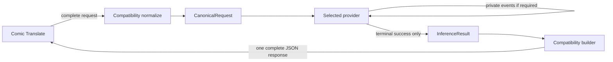

# Compatibility Layer Contract

## 1. Purpose

This document freezes deterministic conversion at the public protocol boundary:

```text
ChatCompletionRequest
        -> compatibility normalization
        -> CanonicalRequest

InferenceResult
        -> compatibility response builder
        -> ChatCompletionResponse
```

It defines architecture behavior, not production models or code. Compatibility
is provider-agnostic, side-effect free, deterministic, free of upstream I/O, and
free of concrete provider, SDK, CLI, OAuth, credential, or session knowledge.

## 2. Inputs and Frozen Prerequisites

Task 03 consumes, without reopening:

| Prerequisite | Accepted artifact | SHA-256 | Ownership |
| --- | --- | --- | --- |
| Task 01 | [Comic Translate Protocol Contract](comic-translate-protocol-contract.md) | `7f38d5fd91962d50209bc56e68e29c1c6ea44427003c84cada78e3bfd08b7523` | What Comic Translate 2.8.9 sends and consumes. |
| Task 02 | [Canonical Domain Contracts](canonical-domain-contracts.md) | `ac71a6ae853dec879f47fe6b403bb04ecf7648eb959b7b8e4c1cda56826edf4b` | What canonical values mean. |

The repository baseline is
`262a7872752d4bc5faa18830c36c83f73cb3d37c`. Provider references are project
constraints, not live capability evidence; upstream SDK/CLI versions remain
unpinned and no live provider call is part of Task 03.

Task 03 owns how public values deterministically become canonical values and how
a successful canonical result becomes a complete public response.

## 3. Compatibility Boundary Principles

1. `normalize_chat_completion_request` and `build_chat_completion_response` are
   pure functions over validated values plus explicit immutable context.
2. No compatibility function performs network, filesystem, process, keyring,
   clock, random, registry, model-discovery, or provider-capability I/O.
3. Compatibility imports public and canonical contracts, never concrete providers.
4. Public syntax acceptance does not promise provider support or forwarding.
5. Messages, content parts, text, images, identity, and known-zero values are
   preserved without silent loss.
6. Invalid public input fails before provider routing; provider and lifecycle
   failures never become partial canonical or public successes.

The OpenAI project reference mentions a Responses adapter under `compatibility/`,
but the higher-priority project architecture prohibits provider-specific protocol
conversion there. This contract resolves placement as follows:

- `compatibility/` owns Chat Completions to/from canonical conversion.
- An OpenAI provider adapter owns `CanonicalRequest` to/from Responses API wire
  values, including `input_image`, `store=False`, events, and parameter filtering.
- The specialized reference should be aligned in a separately authorized
  instruction-maintenance task; its placement example is not implementation
  authority against `project.md`.

## 4. Request Normalization Contract

Conceptual signature:

```text
normalize_chat_completion_request(
    public_request,
    *,
    context: NormalizationContext,
) -> CanonicalRequest
```

`NormalizationContext` contains:

| Field | Rule |
| --- | --- |
| `request_id` | Required opaque nonempty safe identifier, created by the API/lifecycle boundary. |
| `timeout_hint_ms` | Optional positive advisory integer, derived by lifecycle policy. |
| `operation_profile` | Required closed value; `comic_translate_blocks` or `generic_chat`. It is trusted middleware route/configuration context, not client-controlled JSON. |

It contains no credential, user identity, provider, client, session, registry, or
capability value. It is closed. `request_id` must be a string with at least one
non-whitespace character; compatibility treats its contents as opaque and does
not trim it. `timeout_hint_ms`, when present, must be a positive non-boolean
integer. `operation_profile` must be one of its two exact string literals. Empty
IDs, nulls, wrong types, unknown profiles, nonpositive timeouts, and extra fields
reject. Task 06 owns generation and any stronger safety/format policy for IDs.

**Preconditions:** the public value is a strict declared Chat Completions request;
the context is valid. **Rules:** validate and normalize fields in public order,
without provider lookup. **Postconditions:** produce one valid `CanonicalRequest`
whose identity, messages, options, output hint, and context satisfy Task 02.
**Failures:** malformed syntax, unsupported declared values, unknown fields, or
invalid context produce an input-normalization failure; Task 06 owns its public
error category, envelope, and HTTP status.

The function never invokes a provider, performs upstream I/O, reads credentials,
or consults model availability.

## 5. Model Identity Normalization

Public grammar is conceptually `<namespace>:<provider-model-slug>`.

1. Require a string with no leading or trailing whitespace; never trim it.
2. Split on the first colon only.
3. Require namespace syntax `[a-z][a-z0-9_-]*`; uppercase is rejected rather than
   case-folded, preserving one unambiguous public spelling.
4. Require a nonempty slug with no leading or trailing whitespace. The slug is
   otherwise opaque and may contain later colons.
5. Preserve the exact accepted public string as `public_model_id`.
6. Set `provider_id` to the validated namespace and `provider_model_id` to the
   opaque suffix.

Missing colon, empty namespace/slug, whitespace, or malformed namespace rejects
syntactically. A syntactically valid but unknown namespace normalizes; Task 04
owns registry existence, model resolution, ambiguity, and transport selection and
must reject before provider invocation. Compatibility performs no lookup.

## 6. Message and Role Normalization

| Public role | Canonical role | Observed in Task 01? | Rule |
| --- | --- | --- | --- |
| `system` | `system` | Yes | Preserve ordered instruction message. |
| `developer` | `developer` | No | Compatibility-supported architecture extension; preserve role. |
| `user` | `user` | Yes | Preserve ordered requester message. |
| `assistant` | `assistant` | No | Compatibility-supported architecture extension; preserve prior assistant context. |

Roles are exact lowercase literals. Missing, null, wrong-type, or unsupported
roles reject. `messages` is required, non-null, and nonempty. Each message has a
required nonempty ordered content array. Message objects are closed.

No role is reordered, merged, sorted, or converted. In particular, `developer`
does not become `system`. System and developer instructions remain canonical
messages exactly as Task 02 froze; provider-specific single-instruction conversion
belongs to the provider adapter.

## 7. Content-Part Normalization

Public content is a required ordered array. Part objects and nested objects are
closed: undeclared fields reject. Part order is copied exactly.

### 7.1 Text Parts

```json
{"type": "text", "text": "..."}
```

maps to `CanonicalTextPart(kind="text", text=<exact string>)`. `type` and `text`
are required and non-null; `text` must be a string. Empty and whitespace-only
input text are valid and preserved. No trimming, joining, newline normalization,
rewriting, or synthesis occurs.

### 7.2 Image Parts

Accepted public shape:

```json
{
  "type": "image_url",
  "image_url": {"url": "data:image/jpeg;base64,..."}
}
```

Normalization is exactly:

1. Require `type == "image_url"`.
2. Require a non-null closed `image_url` object.
3. Require its non-null string `url` field.
4. Require `data:<media-type>;base64,<payload>`; reject HTTP(S), file, relative,
   parameterized, whitespace-padded, or alternate-encoding references.
5. Require normalized lowercase syntactic media type `image/<subtype>`.
6. Require the literal base64 marker.
7. Decode using strict RFC 4648 validation; do not ignore invalid characters.
8. Require nonempty decoded bytes.
9. Construct `CanonicalImagePart(kind="image", media_type, data=bytes)`.
10. Keep it at the same content-array index.

Task 01 proves `image/jpeg`. Syntactically valid other image media types can become
canonical images; Task 05/provider policy owns evidenced MIME/size support. A
valid canonical image plus an unsupported/unknown provider capability is a later
capability failure, not a parsing failure. Compatibility never fetches or drops
an image and does not ask capabilities whether normalization may succeed.

## 8. Generation Parameter Mapping

| Public field | Task 01 evidence | Classification | Canonical mapping / omission | Provider-policy owner | Observable invalid behavior |
| --- | --- | --- | --- | --- | --- |
| `model` | CT-REQ-007/018 | Canonical | Required -> `ModelIdentity` | Task 04 validates registry/routing | Missing/null/wrong type/syntax rejects. |
| `messages` | CT-REQ-008/011/012/013 | Canonical | Required ordered nonempty messages | Provider maps semantic content | Invalid role/part/shape rejects. |
| `temperature` | CT-REQ-009 | Canonical, provider-mappable | Optional finite number -> `generation.temperature`; omission stays absent | Adapter maps, filters, or rejects | Null, boolean, non-number, NaN, or infinity rejects. |
| `max_completion_tokens` | CT-REQ-010 | Canonical, provider-mappable | Optional positive integer -> `generation.max_generated_units`; omission stays absent | Adapter maps, filters, or rejects | Null, boolean, non-integer, zero, or negative rejects. |
| `stream` | Omitted; CT-REQ-006/021 | Compatibility-only public mode | Omitted or `false` -> one complete response; no canonical field | Future public-stream contract | Null/wrong type or `true` rejects. |
| `response_format` | Not observed | Unsupported/rejected | No canonical mapping and never derives output hint | Future contract revision | Presence rejects, including null. |
| `top_p` | Not observed | Unsupported/rejected | No Task 02 semantic field | Future canonical/provider revision | Presence rejects, including null. |
| `max_tokens` | Not observed | Unsupported/rejected | No mapping; never aliases the frozen field | Future canonical revision | Presence rejects, including null. |
| `seed` | Not observed | Unsupported/rejected | No canonical reproducibility field | Future canonical revision | Presence rejects, including null. |
| Unknown top-level field | None | Unsupported/rejected | None | Contract revision | Presence rejects. |

The required `GenerationOptions` container is created even when both supported
members are omitted. Omission never injects public or canonical defaults.

## 9. Output Hint Derivation

Comic Translate did not send `response_format`. The compatibility layer therefore
does not claim public structured-output intent and does not inspect arbitrary user
text heuristically to identify the application.

When trusted `NormalizationContext.operation_profile` is
`comic_translate_blocks`, compatibility supplies:

```text
kind = block_keyed_textual_json
key_prefix = block_
require_single_json_object = true
```

When the profile is `generic_chat`, `output_hint` is absent. The profile is set by
middleware routing/configuration for the known Comic Translate operation, never
by a public request field. Providers may prompt or enforce the hint where supported;
the response builder still returns exact provider text and performs no JSON repair.

## 10. Transport-Only Fields

| Concern | Owner | Canonical treatment |
| --- | --- | --- |
| HTTP method/route/base URL | FastAPI transport | Excluded. |
| JSON content type/body decoding | FastAPI/public model | Excluded after parsing. |
| `Authorization` / Bearer key | FastAPI auth dependency / Task 07 | Prohibited. |
| Other request headers, socket/client data | FastAPI transport | Excluded. |
| OAuth credentials/provider sessions | Auth/provider boundary | Prohibited. |
| Request ID creation and timeout derivation | API/lifecycle / Task 06 | Only safe opaque ID and advisory timeout enter context. |
| Response ID and timestamp creation | API/lifecycle / Task 06 | Injected into response builder context. |
| Public streaming negotiation | Compatibility transport contract | Omitted/false complete mode; true rejected. |

## 11. Unsupported Input Behavior

Public request, message, content-part, nested image, and context structures are
closed. Unknown fields reject instead of being ignored or forwarded. This avoids
accidental provider coupling and falsely accepted semantics. Compatibility errors
identify a safe field path and stable conceptual category, but Task 06 freezes
the concrete exception hierarchy, status code, and public error body.

Compatibility never silently ignores an image, option, role, or extra field.

## 12. InferenceResult -> Public Response Contract

Conceptual signature:

```text
build_chat_completion_response(
    result: InferenceResult,
    *,
    context: ResponseBuildContext,
) -> ChatCompletionResponse
```

`ResponseBuildContext` requires an opaque nonempty `response_id` and a nonnegative
integer `created_unix_seconds`. The API/lifecycle layer creates them safely after
successful inference. They contain no provider ID, event ID, session ID, OAuth
identifier, credential, or user identity. Explicit injection keeps the builder
pure, deterministic, and testable; it never reads a clock or random source. This
closed context accepts a string `response_id` with at least one non-whitespace
character and a non-boolean integer timestamp greater than or equal to zero.
Empty/null/wrong-type IDs, negative/null/non-integer timestamps, and extra fields
reject. Task 06 owns ID generation and stronger safety/format validation.

Preconditions are a valid `InferenceResult` with `status=completed`, nonempty text,
internally consistent identity, a declared canonical finish reason, valid optional
usage, and a `request_id` equal to the originating normalization context's request
ID supplied by lifecycle orchestration. The postcondition is one complete Chat
Completions response. Provider objects are invalid input. A structurally malformed
result or correlation/identity mismatch is an internal contract violation; a
provider failure or incomplete stream is a lifecycle/provider failure. Both use
Task 06's error path and neither can produce a public success.

## 13. Response Envelope Fields

| Public field | Classification | Deterministic source / rule |
| --- | --- | --- |
| `id` | Compatibility-required, not Comic Translate-consumed | Exact safe `context.response_id`. |
| `object` | Compatibility-required | Literal `chat.completion`. |
| `created` | Compatibility-required, derived | Exact UTC Unix epoch seconds from context; integer and nonnegative. |
| `model` | Compatibility-required, derived | Exact `result.model.public_model_id`; never upstream bare slug. |
| `choices` | Consumer-required | Exactly one item for the one primary result. |
| `choices[0].index` | Compatibility-required | Literal `0`. |
| `choices[0].message.role` | Compatibility-required | Literal `assistant`. |
| `choices[0].message.content` | Consumer-required | Exact nonempty `result.text`; never trimmed/repaired/wrapped. |
| `choices[0].finish_reason` | Compatibility-required | Section 14 mapping. |
| `usage` | Optional | Section 15; omitted when not truthfully token-compatible. |

The builder guarantees `choices`, `choices[0]`, `message`, and string `content`.
Task 01 directly requires only that consumed path; broader fields are explicit
middleware compatibility choices, not mislabeled consumer evidence.

## 14. Finish Reason Mapping

| Canonical | Public value | Rationale |
| --- | --- | --- |
| `stop` | `stop` | Direct compatible meaning. |
| `length` | `length` | Direct compatible meaning. |
| `content_filter` | `content_filter` | Direct compatible meaning. |
| `tool_call` | `tool_calls` | Chat Completions-compatible spelling without provider leakage. |
| `unknown` | `null` | Does not misrepresent an unknown reason as natural stop. |

No raw provider finish value reaches the public response. Whether `tool_call`
without tool payload is usable for this translation operation is a Task 06
success/error policy question; the generic builder maps a valid canonical result.

## 15. Usage Mapping

If usage is absent, omit public `usage`. If `unit == provider_reported`, omit it
rather than falsely label units as tokens. If `unit == token`, emit a usage object
containing only known corresponding fields:

| Canonical count | Public field |
| --- | --- |
| `input_units` | `prompt_tokens` |
| `output_units` | `completion_tokens` |
| `total_units` | `total_tokens` |

Known zero is emitted as `0`; absent remains absent. At least one field exists
because Task 02 rejects empty `UsageInfo`. No missing count is estimated and no
arithmetic total is manufactured.

## 16. Streaming Boundary



Public MVP behavior is non-streaming: omitted or false `stream` yields one complete
JSON response; true is rejected. This does not prohibit a future approved SSE
contract.

An upstream provider may require internal streaming. Its adapter collects raw
events and creates `InferenceResult` only after terminal success. SIWC uses
`store=False`, `stream=True`, waits for `response.completed`, and treats
`response.failed` or premature termination as provider/lifecycle failure.
Compatibility never consumes Responses events or returns partial success.

## 17. Provider Policy Boundary

Compatibility parses and preserves canonical semantic options. The selected
adapter decides, from evidenced provider policy, whether each canonical option is
mapped, filtered, or rejected. It must not mutate the already-built canonical
request or claim a filtered option was applied.

Prohibited compatibility logic includes provider-name or concrete-class branches.
For SIWC, public `temperature` and `max_completion_tokens` remain canonical, while
the OpenAI provider adapter omits unsupported upstream fields. It also owns
Responses `input_image` conversion and private event collection. Public acceptance
therefore does not imply blind upstream forwarding.

## 18. Error Ownership Boundary

| Failure family | Owner |
| --- | --- |
| Malformed model syntax, role, content, image data URI/base64, generation option, closed field | Compatibility/input validation |
| Unknown namespace/model, ambiguous route, transport selection | Task 04 router |
| Unsupported/unknown image, role, instruction, option capability | Task 04/05 provider and capability policy |
| Rate limit, OAuth failure, upstream timeout, CLI failure, failed/premature stream, malformed provider output | Provider/lifecycle; Task 06 |
| HTTP status, OpenAI-compatible error envelope, retry/deadline/cancellation/redaction | Task 06 |

Normalization never interprets provider failures. The response builder never
accepts a failure or partial provider object.

## 19. End-to-End Written Mapping Cases

### Case 1: Text-only Comic Translate operation

Public input uses `openai:gpt-example`, ordered system/user text arrays,
`temperature: 1.0`, and `max_completion_tokens: 5000`. With operation profile
`comic_translate_blocks`, normalization produces triple identity, unchanged
ordered text, generation `{temperature: 1.0, max_generated_units: 5000}`, the
block-keyed hint, and injected request context.

A synthetic completed result containing `{"block_0":"Hello"}` becomes one
assistant choice whose content is exactly that string, model is
`openai:gpt-example`, and finish reason is `stop`. Future assertions compare the
entire canonical value: triple identity, two ordered messages and exact text,
generation values, block hint, request ID, and absent timeout. Given build context
`response_id="chatcmpl_case_1"` and `created_unix_seconds=1`, they compare the
entire public envelope: those exact metadata values, object `chat.completion`,
public model, one index-zero assistant choice, exact content, `stop`, and omitted
usage. Result request ID and model identity must match the originating request.
Cases 2 and 3 inherit these complete-envelope assertions unless they state a
different explicit input value; “same envelope” is normative field-for-field
equality, not a shape-only assertion.

### Case 2: Multimodal Comic Translate operation

The user content `[text, data:image/jpeg;base64,AA==]` becomes, in the same order,
the exact text and `CanonicalImagePart(media_type="image/jpeg", data=b"\x00")`.
No provider is called during decoding. A synthetic completed result maps back to
one complete response whose content is exactly `{"block_0":"Hello"}`; the image
is not echoed publicly. Future assertions compare media type, one zero byte,
`[text,image]` indexes, the full canonical value, request/model correlation, and
every inherited Case 1 public field, including injected ID/time, object, public
model, one index-zero assistant choice, exact content, finish reason, and usage
omission.

### Case 3: SIWC filtering ownership

Public temperature and maximum normalize unchanged into canonical semantics. Task
04 selects the SIWC adapter. A provider-policy mock captures both values on its
canonical input, captures neither `temperature` nor any maximum-output field in
the upstream payload, and captures `store=False` and `stream=True`. For synthetic
events `[text_delta("Hello"), response.completed]`, no result exists after the
delta and one completed result exists only after the terminal event. Generic
compatibility contains no SIWC branch and builds the same public envelope as for
any provider. Future assertions compare the full canonical input and every
inherited Case 1 public field. For `[text_delta("partial"), response.failed]` or a
delta followed by end-of-stream, assert no `InferenceResult`, no response-builder
invocation, and no public success.

## 20. Negative Compatibility Cases

| Case | Rejection layer | Conceptual category | Future assertion |
| --- | --- | --- | --- |
| Missing/null/bare/malformed model | Compatibility | Invalid input | No canonical request/provider call. |
| Valid syntax but unknown namespace | Task 04 | Routing failure | Normalization succeeds; no provider call after lookup fails. |
| Empty messages or content | Compatibility | Invalid input | Reject with field path. |
| Unsupported/null role | Compatibility | Invalid input | Preserve no partial message. |
| Unknown content type/field | Compatibility | Invalid input | Closed union rejects. |
| Missing/null image URL | Compatibility | Invalid image | No canonical image. |
| Remote HTTP image | Compatibility | Unsupported representation | No fetch occurs. |
| Malformed/missing-media/non-base64 URI | Compatibility | Invalid image | Strict rejection. |
| Invalid base64 or empty bytes | Compatibility | Invalid image | Strict rejection. |
| Invalid/null/nonfinite temperature | Compatibility | Invalid option | No canonical request. |
| Invalid/null/nonpositive maximum | Compatibility | Invalid option | No canonical request. |
| Credential-shaped canonical/context field | Domain validation | Security boundary | Reject; never log value. |
| Provider/SDK/event object passed to builder | Compatibility/domain | Boundary violation | No public response. |
| Missing/empty/partial `InferenceResult.text` | Provider/domain/Task 06 | Invalid success | No public success. |
| Result/context request ID mismatch | Compatibility/lifecycle contract | Internal contract violation | No public response. |
| Inconsistent/missing result identity | Domain/compatibility | Internal contract violation | No public response or bare slug leak. |
| Unsupported status or invalid/missing canonical finish reason | Domain/compatibility | Internal contract violation | No public response. A missing/unmapped raw provider reason is different: the adapter must first normalize it to canonical `unknown`. |
| Invalid usage unit, empty usage, negative/contradictory comparable counts | Domain/compatibility | Internal contract violation | No fabricated usage or public success. |
| Invalid normalization/build context | Compatibility | Invalid context | No canonical request or public response. |
| Public `stream=true` | Compatibility | Unsupported public mode | No provider invocation. |

## 21. Future Contract-Test Inventory

No tests are implemented by Task 03.

| ID | Future test | Expected assertion |
| --- | --- | --- |
| CCV-001 | Observed text-only request | Exact canonical identity/messages/options/hint/context. |
| CCV-002 | Multimodal request | Strict JPEG decode and `[text,image]` order. |
| CCV-003 | Message order | Mixed supported roles retain exact order. |
| CCV-004 | Content order | No grouping/reordering by type. |
| CCV-005 | Model first-colon parsing | Later slug colons preserved. |
| CCV-006 | Model syntax matrix | Empty, whitespace, uppercase/malformed namespace reject. |
| CCV-007 | Unknown namespace | Syntax succeeds; mocked router owns rejection. |
| CCV-008 | Role matrix | Four roles map directly; unsupported role rejects. |
| CCV-009 | Text semantics | Empty/whitespace/exact newlines preserved. |
| CCV-010 | Image nested shape | Missing/null/extra fields reject. |
| CCV-011 | Remote/file image | Reject without network/filesystem access. |
| CCV-012 | Data URI/base64 matrix | Marker, MIME, strict alphabet/padding validated. |
| CCV-013 | Empty image bytes | Reject before canonical construction. |
| CCV-014 | Temperature mapping | Finite value preserved; omission absent. |
| CCV-015 | Temperature invalid matrix | Null/bool/non-number/nonfinite reject. |
| CCV-016 | Maximum mapping | Positive integer maps; omission absent. |
| CCV-017 | Maximum invalid matrix | Null/bool/fraction/zero/negative reject. |
| CCV-018 | Closed public fields | Listed unsupported and unknown fields reject. |
| CCV-019 | Output profile | Block hint only for trusted Comic Translate profile. |
| CCV-020 | Transport credential exclusion | Headers/auth never enter canonical values. |
| CCV-021 | Result text response | Exact text at `choices[0].message.content`. |
| CCV-022 | Response identity | Public namespaced model preserved; no bare slug. |
| CCV-023 | Deterministic envelope context | Injected ID/time reproduced exactly; no hidden clock/randomness. |
| CCV-024 | Finish mapping | Five canonical values map as documented. |
| CCV-025 | Token usage | Known partial/full/zero counts map without fabrication. |
| CCV-026 | Unknown/non-token usage | Absent/provider-reported usage omitted. |
| CCV-027 | Complete-result precondition | Empty/failed/partial result cannot build success. |
| CCV-028 | Public stream modes | Omitted/false complete; true rejects. |
| CCV-029 | Internal stream success | Mock adapter returns only after terminal completion. |
| CCV-030 | Internal stream failure | Failed/premature mock stream yields no result/public success. |
| CCV-031 | SIWC parameter ownership | Canonical retains options; mocked provider policy filters them. |
| CCV-032 | Provider isolation | Compatibility tests use canonical mocks without provider imports. |
| CCV-033 | Side-effect freedom | Normalizer/builder perform no I/O, registry, clock, or random calls. |
| CCV-034 | Normalization context matrix | Empty/null/wrong-type request ID, unknown/null/wrong-type profile, nonpositive/null/wrong-type timeout, and extras reject. |
| CCV-035 | Response build context matrix | Empty/null/wrong-type response ID, negative/null/non-integer timestamp, and extras reject. |
| CCV-036 | Result correlation | Mismatched request ID is an internal contract violation with no response. |
| CCV-037 | Result identity/status matrix | Missing/inconsistent identity or non-completed status cannot build success. |
| CCV-038 | Result finish/usage matrix | Missing/invalid reason and invalid unit/empty/negative/contradictory comparable usage reject. |
| CCV-039 | Role-order extensions | Mixed system/developer/user/assistant messages preserve exact order and actors. |
| CCV-040 | Unknown namespace handoff | Normalization succeeds; mocked Task 04 rejects before provider invocation. |
| CCV-041 | Stream event sequences | Delta+completed succeeds only at completion; delta+failed and delta+EOF yield no result/response. |
| CCV-042 | Written cases | Full canonical and public values equal the explicit Case 1–3 assertions. |
| CCV-043 | Finish reason boundary | Missing/unmapped raw provider reason normalizes to canonical `unknown` and public null; missing/invalid canonical reason rejects. |
| CCV-044 | Failure-family distinction | Malformed canonical result prevents builder invocation as an internal contract violation; provider failure/incomplete stream produces no result and therefore no builder invocation. |
| CCV-045 | Repeated role ordering | Repeated and mixed system/developer/user/assistant messages retain exact actors and order. |

## 22. Compatibility Invariants

| ID | Invariant |
| --- | --- |
| CCI-001 | Request normalization performs no provider or other external I/O. |
| CCI-002 | Response construction is pure and uses explicit deterministic context. |
| CCI-003 | Generic compatibility imports no concrete provider, SDK, CLI, event, or process type. |
| CCI-004 | Public message order is preserved exactly. |
| CCI-005 | Public content-part order is preserved exactly. |
| CCI-006 | Text is not trimmed, joined, rewritten, or synthesized. |
| CCI-007 | Images are strictly decoded and never fetched, silently discarded, or reordered. |
| CCI-008 | Public credentials and provider sessions never enter canonical/build contexts. |
| CCI-009 | Public acceptance does not imply provider forwarding or capability support. |
| CCI-010 | Provider-specific mapping/filtering occurs only after canonical normalization. |
| CCI-011 | Response construction consumes only a valid completed `InferenceResult`. |
| CCI-012 | `choices[0].message.content` equals canonical result text exactly. |
| CCI-013 | Public response model preserves the public namespaced identity. |
| CCI-014 | Raw upstream streams/events never enter compatibility or partial public success. |
| CCI-015 | Unknown usage is not zero and non-token units are not labeled as tokens. |
| CCI-016 | Undeclared public fields reject rather than disappear or pass through. |
| CCI-017 | Public non-streaming and private provider streaming remain separate. |
| CCI-018 | IDs are opaque, safe, and free of credentials or user/session identity. |

## 23. Decision Registry

| ID | Decision | Rationale / evidence | Downstream impact | Revisit trigger |
| --- | --- | --- | --- | --- |
| CCD-001 | Parse identity at first colon with strict lowercase namespace and no trimming. | CDD-001; unambiguous syntax. | Task 04 receives stable identity. | Accepted public grammar change. |
| CCD-002 | Registry/model/transport validation is Task 04, not normalization. | Dependency direction. | Valid unknown namespaces normalize then fail routing. | Task 04 proves syntax insufficient. |
| CCD-003 | Four roles map directly and remain ordered messages. | CDD-002. | Providers preserve or reject semantics. | Canonical role revision. |
| CCD-004 | Content is closed text/image; public schemas are closed. | CDD-003; loss prevention. | Unknown values reject. | Approved compatibility extension. |
| CCD-005 | Images require strict local data-URI decode to bytes/media type. | CT-REQ-013; CDD-004. | Providers receive first-class image. | Approved remote-image policy. |
| CCD-006 | Supported generation options preserve omission and values. | CDD-005; CT-REQ-009/010. | Adapters map/filter/reject. | Canonical option revision. |
| CCD-007 | Unsupported/unknown public fields reject. | Closed-model policy; truthfulness. | No silent passthrough. | Explicit field support approved. |
| CCD-008 | Output hint derives only from trusted operation profile. | CT-REQ-015/016; A-001 resolution. | Generic chat is not overclassified. | New safe application classifier. |
| CCD-009 | Transport/auth values are excluded. | CDI-007/018. | Tasks 06/07 own lifecycle/auth. | Never for credentials. |
| CCD-010 | Response ID/time are injected through build context. | Determinism and testability. | Task 06 defines generation. | Lifecycle contract changes. |
| CCD-011 | Response has exactly one assistant choice with exact result text/public model. | CT-REQ-014; CDD-007. | Consumer path guaranteed. | Canonical multi-output revision. |
| CCD-012 | Unknown finish maps to null; tool call maps to `tool_calls`. | Avoid false natural-stop claim. | Task 06 decides unusable translation outcomes. | Public compatibility requirement changes. |
| CCD-013 | Token usage maps partially/truthfully; absent or non-token usage is omitted. | CDD-009. | No fabricated token metadata. | Public non-token extension. |
| CCD-014 | Public streaming is unsupported; internal streams are provider-private. | CT-REQ-006/021; CDI-017. | Complete response only. | Approved public SSE contract. |
| CCD-015 | Provider adapters own filtering, Responses conversion, and event collection. | CDI-014/015; project priority. | No provider branch in compatibility. | Project architecture revision. |
| CCD-016 | Compatibility errors remain conceptual until Task 06 maps HTTP/error envelopes. | Scope ownership. | Stable rejection semantics, deferred transport. | Task 06 begins. |

## 24. Deferred Decisions

| ID | Deferred decision | Owner | Reason | Trigger |
| --- | --- | --- | --- | --- |
| CCD-D01 | Registry, unknown model, Google transport, routing collision policy | Task 04 | Provider resolution ownership | Task 04 design. |
| CCD-D02 | Capability evidence, MIME/size limits, role/option support | Task 05 | Catalog/capability ownership | Task 05 design. |
| CCD-D03 | Error classes, HTTP statuses/envelopes, malformed output policy | Task 06 | Lifecycle/error ownership | Task 06 design. |
| CCD-D04 | Safe ID generation, clock source, deadlines, retries, cancellation | Task 06 | Side-effect/lifecycle ownership | Task 06 design. |
| CCD-D05 | Bearer validation and auth endpoints | Task 07 | Security/auth ownership | Task 07 design. |
| CCD-D06 | Concrete Pydantic serializers and executable tests | Implementation wave | Architecture-only scope | Implementation authorized. |
| CCD-D07 | Public SSE, tools, multiple choices, extra fields/content kinds | Future approved revision | No Task 01 requirement/canonical support | Evidence-backed scope approval. |
| CCD-D08 | Align OpenAI reference adapter placement wording | Instruction maintenance | Task 03 cannot modify instructions; project rule already resolves runtime architecture | Separate documentation authorization. |

## 25. Downstream Implications

- Task 04 must resolve syntactically valid identities and capabilities without
  changing compatibility parsing or importing providers backward.
- Task 05 must treat unknown capability as rejection and evidence MIME/size support.
- Task 06 must preserve complete-success-only building, injected safe IDs/time,
  conceptual failure boundaries, and no partial stream success.
- Task 07 must keep Bearer/provider credentials outside all canonical values.
- Task 08 must verify the CCI registry and both prerequisite traceability matrices.

### Task 01 traceability

| Requirement | Task 03 handling | Result |
| --- | --- | --- |
| CT-REQ-001 | Route/base URL is transport-owned. | Accounted |
| CT-REQ-002 | JSON is parsed by transport/public model before normalization. | Accounted |
| CT-REQ-003 | Content type is transport validation. | Accounted |
| CT-REQ-004 | Bearer auth is excluded from canonical values. | Accounted |
| CT-REQ-005 | Normalization has no model-list precondition. | Accounted |
| CT-REQ-006 | Omitted stream yields one complete response. | Accounted |
| CT-REQ-007 | Required public model maps to triple identity. | Accounted |
| CT-REQ-008 | Ordered system/user messages map directly. | Accounted |
| CT-REQ-009 | Temperature maps without provider filtering. | Accounted |
| CT-REQ-010 | Maximum maps to `max_generated_units`. | Accounted |
| CT-REQ-011 | System text-part array is preserved. | Accounted |
| CT-REQ-012 | User text-part array is preserved. | Accounted |
| CT-REQ-013 | JPEG data URI strictly decodes at the same position. | Accounted |
| CT-REQ-014 | Exact result text becomes `choices[0].message.content`. | Accounted |
| CT-REQ-015 | Trusted Comic Translate profile supplies block output hint. | Accounted |
| CT-REQ-016 | Builder preserves exact text; no brace/JSON repair. | Accounted |
| CT-REQ-017 | Broader metadata is compatibility-required, not consumer-required. | Accounted |
| CT-REQ-018 | Valid namespaced manual ID parses; no consumer validation assumed. | Accounted |
| CT-REQ-019 | Discovery is not required for normalization. | Accounted |
| CT-REQ-020 | Input/provider failures cannot become malformed success; Task 06 maps errors. | Accounted |
| CT-REQ-021 | Public SSE is not offered; internal streaming is separate. | Accounted |
| CT-REQ-022 | Optional metadata is truthful and independently sourced. | Accounted |

### Task 02 invariant traceability

| Invariant | Task 03 handling | Result |
| --- | --- | --- |
| CDI-001 | Produces canonical request and consumes canonical result only. | Preserved |
| CDI-002 | Triple identity built consistently and returned publicly. | Preserved |
| CDI-003 | Syntax rejects here; unknown/ambiguous route rejects in Task 04 before invocation. | Preserved |
| CDI-004 | Both orderings copy exactly. | Preserved |
| CDI-005 | Images are first-class and never dropped. | Preserved |
| CDI-006 | Text is copied exactly. | Preserved |
| CDI-007 | Auth/credential/session data is prohibited. | Preserved |
| CDI-008 | SDK/HTTP/process/event objects are excluded. | Preserved |
| CDI-009 | Data URI/base64 is strictly validated. | Preserved |
| CDI-010 | Capability validation remains explicit after routing. | Preserved |
| CDI-011 | Builder requires completed result with nonempty text. | Preserved |
| CDI-012 | Usage absence and known zero remain distinct. | Preserved |
| CDI-013 | Builder sees canonical unknown only and emits null. | Preserved |
| CDI-014 | Filtering stays in selected adapter. | Preserved |
| CDI-015 | No concrete provider import or branch. | Preserved |
| CDI-016 | Compatibility never treats capability absence as support. | Preserved |
| CDI-017 | Public complete response and private stream are separate. | Preserved |
| CDI-018 | Correlation/build IDs are safe and opaque. | Preserved |

## 26. Review State

Primary Architecture & Security design identified a provider-adapter placement
wording conflict in the OpenAI reference. The Coordinator resolved it by applying
the documented instruction priority: `project.md` governs dependency direction,
and provider-specific Responses conversion remains in the provider adapter. The
specialized wording correction is deferred as CCD-D08 because instruction edits
are outside Task 03.

Implementation & Testing first returned `APPROVE WITH REQUIRED CHANGES` for
context/result predicates, complete written assertions, stream sequences, and the
raw-provider-versus-canonical finish-reason distinction. Those findings were
resolved in `CCV-034` through `CCV-045`; a fresh final verification returned
`APPROVE` with no blocking, important, testability-gap, missing-case, or ambiguous-
outcome findings.

A fresh independent Architecture & Security review then returned `APPROVE` with
no blocking, important, or optional findings. It confirmed complete Task 01 and
Task 02 traceability, provider independence, security boundaries, and the
`project.md`-priority resolution recorded by CCD-D08. The artifact is ready for
explicit user approval. The user explicitly approved Task 03 on 2026-10-13; the
artifact is completed for commit.

No Google specialist is required: Task 03 makes no new Google capability claim.

## 27. Task 03 Freeze

Task 03 freezes pure public-to-canonical normalization, strict model/content/image
syntax, ordered role semantics, generation-option preservation, trusted output-hint
derivation, transport exclusion, deterministic result-to-public construction,
truthful finish/usage metadata, complete public responses, provider-side policy,
and public/internal streaming separation.

It does not implement code, models, endpoints, providers, tests, routing, catalog,
OAuth, errors, or lifecycle policy. Task 04 is not started by this document.