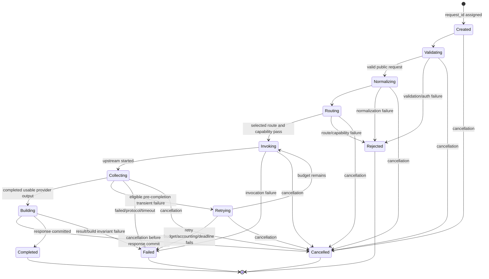

# Error, Reliability, and Request Lifecycle

## 1. Purpose

This Task 06 architecture artifact freezes the provider-neutral failure contract,
request lifecycle, and reliability ownership for the Comic Translate middleware.
It is conceptual only: no handler, exception class, retry loop, SDK call,
subprocess operation, test, or credential operation is implemented here.

The governing success path remains:

```text
CanonicalRequest -> ProviderRouter -> selected BaseProvider -> InferenceResult
```

A failed path never creates an `InferenceResult` or a Chat Completions success.

## 2. Scope and Classifications

**Frozen decision** is change-controlled. **Invariant** is mandatory for every
implementation. **Evidence-backed fact** is supported by the cited local source.
**Assumption** is not evidence. **Deferred decision** has an owner and trigger.
**Unverified** means no live verification was performed or claimed.

In scope: normalized failures, public error envelopes, lifecycle states,
deadlines, cancellation, cleanup, retry safety, logging/redaction, and future
validation seams. Out of scope: implementation, concrete numeric retry/backoff
settings, HTTP-client/process APIs, auth flows, credential storage, tests, and
any Comic Translate change.

## 3. Inputs and Evidence

| Input | Accepted evidence | Use |
| --- | --- | --- |
| Task 01 protocol | `comic-translate-protocol-contract.md`, SHA-256 `7f38d5fd91962d50209bc56e68e29c1c6ea44427003c84cada78e3bfd08b7523` | Complete response and consumer failure evidence |
| Task 02 canonical | `canonical-domain-contracts.md`, SHA-256 `ac71a6ae853dec879f47fe6b403bb04ecf7648eb959b7b8e4c1cda56826edf4b` | Completed-success `InferenceResult` contract |
| Task 03 compatibility | `compatibility-contract.md`, SHA-256 `30e6d0e6788a4b5fda69225770f332a4119aea6dc3b6d35ac3373e2b981219fb` | Public response construction and pure boundary |
| Task 04 routing | `provider-contract-and-routing.md`, SHA-256 `fbb9ff3084cdec737f8b76be7b3579291cc4be34d474c8fd07e73b492509bdff` | Single selected provider and no fallback |
| Task 05 terminology | `model-catalog-and-capabilities.md` | Availability terminology only; not a Task 06 dependency |
| Local provider references | OpenAI and Google/Antigravity instruction documents | Terminal-event and CLI-result constraints; versions unpinned |

The upstream references are design constraints, not live capability proof. In
particular, the `agy` event schema is unpinned and must be treated as adapter-local
and version-validated before implementation.

## 4. Governing Principles

1. `CanonicalRequest` is the sole internal inference input; `InferenceResult` is
   only a completed, usable provider output.
2. Compatibility remains provider-agnostic and never imports provider, SDK, CLI,
   event, or process types.
3. One explicit route invokes one selected provider once per lifecycle attempt;
   there is no provider fallback.
4. All terminal paths release owned resources and report one safe public outcome.
5. Public errors are deterministic, secret-free, and use the envelope in Section 9.
6. A deadline budget only decreases; cancellation is not a timeout.
7. Raw provider diagnostics are evidence for classification, never public detail.

## 5. Failure Model

A failure is normalized at the closest owning boundary, preserving a safe category,
origin, request correlation, retry eligibility, and sanitized diagnostic code.
Provider-specific exceptions, HTTP bodies, stream events, process exit data, and
stderr remain adapter-local. Lifecycle/orchestration makes the final retry,
cleanup, terminal-state, and public-response decision.

A category describes the stable semantic outcome, not an SDK exception class. A
single observed transport failure may be classified only when its evidence is
sufficient; otherwise it becomes `ProviderProtocolError` or `InternalError`, not a
guessed auth, quota, or model outcome.

## 6. Conceptual Exception Tree

```text
MiddlewareError
├── ValidationError
├── AuthenticationError
│   ├── LocalAuthenticationError
│   └── UpstreamAuthenticationError
├── AuthorizationError
│   ├── LocalAuthorizationError
│   └── UpstreamAuthorizationError
├── ModelNotFoundError
├── UnsupportedCapabilityError
├── ProviderRateLimitError
├── ProviderUnavailableError
├── ProviderTimeoutError
├── ProviderProtocolError
├── RequestCancelledError
├── ConfigurationError
└── InternalError
```

`LocalAuthenticationError` and `UpstreamAuthenticationError` (likewise
authorization) are internal variants because remediation, logging, and trust
boundaries differ. They serialize through the parent category, never disclose the
selected credential mode, token state, account, or session. `RequestCancelledError`
is justified because requester disconnect/cancellation is distinct from a provider
timeout. `ConfigurationError` is justified only for invalid middleware composition,
such as a missing configured binding; it must not expose paths, environment values,
or secrets. It is an `InternalError`-family startup/readiness failure, not a
request-time provider-availability category.

## 7. Category Semantics

| Category | Meaning | Typical origin | Retry by lifecycle? |
| --- | --- | --- | --- |
| `ValidationError` | Public/canonical input is invalid | API or compatibility | No |
| `AuthenticationError` | Required local or selected-upstream auth is absent/invalid/expired | API/auth/provider | No |
| `AuthorizationError` | Authenticated principal is not allowed | API/auth/provider | No |
| `ModelNotFoundError` | Selected namespaced model is unknown or authoritatively unavailable | router/catalog/provider | No |
| `UnsupportedCapabilityError` | Required semantic capability is unsupported or unknown | router/provider | No |
| `ProviderRateLimitError` | Selected upstream rejects for quota/rate limit | provider | Bounded, only before uncertain completion |
| `ProviderUnavailableError` | Selected upstream/service/transport is transiently unavailable | provider | Bounded, only before uncertain completion |
| `ProviderTimeoutError` | Absolute deadline expires before usable terminal success | lifecycle/provider | No after deadline |
| `ProviderProtocolError` | Upstream output/event/exit contract is malformed or incomplete | provider adapter | No |
| `RequestCancelledError` | Requester/application cancellation wins before terminal success | lifecycle | No |
| `ConfigurationError` | Invalid local composition or configured binding | composition/router | No |
| `InternalError` | Unexpected invariant or orchestration failure | any internal layer | No by default |

## 8. Classification Evidence Rules

Classification must use stable, sanitized evidence: known local validation failure,
known local auth decision, documented upstream status/code, a terminal provider
event, controlled process exit/result, or a violated frozen invariant. Free-form
exception strings, raw stderr, response bodies, and stack traces do not alone
justify a more specific public class.

Rate limiting requires a documented rate/quota signal. Unavailable requires a
transient service/connection/maintenance signal. Protocol failure means the
transport reached an unusable output state, such as malformed JSON, a missing
terminal event, non-success CLI terminal result, nonzero exit, or absent required
text. An uncertain post-dispatch interruption is neither safe success nor safe
retry evidence.

## 9. Public OpenAI-Compatible Error Envelope

Every `/v1/*` failure for which HTTP delivery remains applicable serializes exactly
this JSON shape, with no extra JSON correlation field. Pre-commit cancellation is
the sole exception: lifecycle terminates transport delivery and emits no HTTP
response or public error envelope.

```json
{
  "error": {
    "message": "The selected provider did not return a completed response.",
    "type": "api_error",
    "param": null,
    "code": "provider_protocol_error"
  }
}
```

The only fields inside `error` are `message`, `type`, `param`, and `code`.
`param` is a string field path only for safe client-correctable input errors;
otherwise it is `null`. Correlation is conveyed by a safe response header such as
`X-Request-ID` and structured logs, not by an extra JSON field. Stack traces,
raw SDK errors, raw stderr, provider body text, credentials, paths, account IDs,
and session details are forbidden from this envelope.

The exact four-field shape applies only to the `error` JSON object and its members;
headers, including `X-Request-ID` and eligible `Retry-After`, remain outside that
JSON object.

## 10. Public Error Field Contract

| Field | Rule |
| --- | --- |
| `message` | Stable, actionable, secret-free human text; no raw upstream diagnostic interpolation |
| `type` | `invalid_request_error`, `authentication_error`, `permission_error`, `not_found_error`, `rate_limit_error`, or `api_error` |
| `param` | Safe public field path for validation only; otherwise JSON `null` |
| `code` | Stable lowercase middleware code; never an unfiltered upstream code |
| `X-Request-ID` | Safe opaque correlation ID on every response once created; omitted only if transport cannot send a response |
| `Retry-After` | May be emitted only for 429/503 when a finite sanitized upstream hint exists; never invent it, cap it by the configured finite cap and remaining budget |

Synthetic validation example:

```json
{"error":{"message":"messages must be a non-empty array.","type":"invalid_request_error","param":"messages","code":"invalid_request_error"}}
```

Synthetic local-auth example:

```json
{"error":{"message":"Missing or invalid local API key.","type":"authentication_error","param":null,"code":"invalid_api_key"}}
```

Synthetic rate example:

```json
{"error":{"message":"The selected provider is rate limited. Retry later.","type":"rate_limit_error","param":null,"code":"provider_rate_limit"}}
```

Synthetic unavailable/timeout examples:

```json
{"error":{"message":"The selected provider is temporarily unavailable.","type":"api_error","param":null,"code":"provider_unavailable"}}
{"error":{"message":"The request exceeded its execution deadline.","type":"api_error","param":null,"code":"provider_timeout"}}
```

## 11. Deterministic HTTP Matrix

| HTTP | Normalized category | `type` | Safe code | Public meaning |
| --- | --- | --- | --- | --- |
| 400 | ValidationError or UnsupportedCapabilityError | `invalid_request_error` | `invalid_request_error` or `unsupported_capability` | Client request cannot be processed as requested |
| 401 | AuthenticationError | `authentication_error` | `invalid_api_key` or `upstream_authentication_failed` | Local or selected upstream authentication failed |
| 403 | AuthorizationError | `permission_error` | `permission_denied` or `upstream_authorization_failed` | Authenticated caller/path lacks permission |
| 404 | ModelNotFoundError | `not_found_error` | `model_not_found` | Selected public model is unavailable/not found |
| 429 | ProviderRateLimitError | `rate_limit_error` | `provider_rate_limit` | Selected provider rejected for rate/quota |
| 500 | InternalError or ConfigurationError | `api_error` | `internal_error` or `configuration_error` | Middleware composition is invalid or an internal invariant failed; invalid composition prevents readiness |
| 502 | ProviderProtocolError | `api_error` | `provider_protocol_error` | Upstream returned unusable output/protocol evidence |
| 503 | ProviderUnavailableError | `api_error` | `provider_unavailable` | Selected, otherwise valid path has a temporary request-time prerequisite or provider outage |
| 504 | ProviderTimeoutError | `api_error` | `provider_timeout` | Deadline expired before completed usable output |
| no response | RequestCancelledError | n/a | n/a | Pre-commit cancellation terminates transport delivery; no envelope is serialized |

A documented upstream 400/401/403/404/429 is mapped by semantics, not copied
mechanically. An authoritative model-not-found signal alone maps to 404; absent
that authority, the applicable provider category wins. A transport-level
connection/refusal outcome before dispatch is 503 only when it is positively
classified as transient availability; verified malformed or contradictory terminal
evidence is 502; post-dispatch connection loss without deadline is 502; and an
elapsed middleware deadline is always 504.

`UnsupportedCapabilityError` always maps to 400, regardless of whether the
rejection occurs at a router gate, provider applicability check, or adapter-local
capability validation. A missing configured binding is invalid composition and
prevents readiness as `ConfigurationError`/500; if it is somehow reached during a
request, it still fails as `ConfigurationError`/500, never as 503.

## 12. Authentication Variants

Local Bearer authentication is evaluated before normalization/routing and produces
`LocalAuthenticationError` or `LocalAuthorizationError`. Selected-provider auth is
private provider/auth evidence and produces `UpstreamAuthenticationError` or
`UpstreamAuthorizationError`. Both have the same public 401/403 families but
separate internal remediation and audit fields.

No public message identifies an OAuth provider, API-key mode, SIWC state, Google
CLI session, keyring, token expiry, or account. Task 07 owns credential lifecycle,
PKCE, status surfaces, storage, refresh, and logout; this task only freezes their
error/lifecycle boundary.

## 13. Layer Ownership

| Layer | Owns | Must not own |
| --- | --- | --- |
| `api/` | Transport parsing, request-scoped correlation attachment, exception-to-response transport | Provider execution, retry, auth/provider logic |
| `compatibility/` | Pure validation/normalization and successful response building | HTTP status, SDK/CLI diagnostics, retry, cleanup |
| lifecycle/orchestration | Deadline, cancellation, one retry owner, terminal state, cleanup coordination | Provider payload conversion or public parsing |
| router/catalog | Deterministic selected route, capability/availability gates | Fallback, retries, error serialization |
| provider adapter | Upstream conversion, terminal evidence collection, local normalization of upstream failures | Public envelope, cross-provider fallback |
| `auth/` | Local/upstream auth service outcomes and credential lifecycle | Canonical credentials or public secret disclosure |
| composition/lifespan | Long-lived resource construction/shutdown | Per-request policy |

## 14. Lifecycle Diagram



  The four terminal states are exactly `Rejected`, `Completed`, `Failed`, and
  `Cancelled`. `Rejected` is a pre-invocation failure outcome. No terminal state
  has an outgoing transition.

## 15. State and Transition Table

| State | Owner | Allowed next state | Exit condition |
| --- | --- | --- | --- |
| Created | API/lifecycle | Validating, Cancelled | Safe request ID and absolute deadline exist |
| Validating | API/auth | Normalizing, Rejected, Cancelled | Public/auth boundary decided |
| Normalizing | compatibility | Routing, Rejected, Cancelled | Valid `CanonicalRequest` or failure |
| Routing | router/catalog | Invoking, Rejected, Cancelled | One selected provider and capability gate pass |
| Invoking | lifecycle/provider | Collecting, Failed, Cancelled | Upstream operation starts or fails |
| Collecting | provider/lifecycle | Building, Retrying, Failed, Cancelled | Terminal evidence, eligible retry, or terminal failure |
| Retrying | lifecycle | Invoking, Failed, Cancelled | Effective budget and deadline permit another attempt |
| Building | compatibility/lifecycle | Completed, Failed, Cancelled | Complete response is built and atomically committed, or arbitration selects failure/cancellation |
| Rejected | lifecycle | none | Pre-invocation 4xx result; invalid composition prevents readiness before a request |
| Completed | lifecycle | none | One complete public success response is committed |
| Failed | lifecycle | none | One normalized error is committed or transport is gone |
| Cancelled | lifecycle | none | Work is stopped/cleanup attempted; no public success |

## 16. Terminal Success Rules

`Completed` requires all of the following: one valid `CanonicalRequest`; exactly
one selected route; a valid `InferenceResult` with matching request ID, preserved
public namespaced model, `status=completed`, and nonempty primary text; terminal
provider success; successful compatibility response construction; a positive
remaining-budget check immediately before response commit; and winning atomic
terminal arbitration. Response commit is the one-way lifecycle action that makes
the complete public success response available to the HTTP transport. After that
commit, cancellation and cleanup failure cannot replace `Completed` or its
response; before it, either may prevent success according to arbitration.

For OpenAI SIWC, deltas are insufficient and `response.completed` is required;
`response.failed` or end-of-stream first is failure. For CLI execution, a usable
result requires parseable final data, explicit success terminal status, zero exit,
and nonempty primary text. For the Comic Translate profile, if required primary
text is absent, no `InferenceResult` exists. A terminal `tool_call` finish outcome
without a usable primary translation text is unusable provider output and must
fail; it must not be emitted as a Chat Completions success.

## 17. Stream Semantics

Internal streams are provider-private. An adapter may accumulate deltas only as
transient state and may construct `InferenceResult` only after required terminal
success. Partial text, a failed event, an EOF without required terminal event,
malformed event data, or a completion lacking usable primary text produces no
result and no success response.

The OpenAI SIWC provider keeps `store=False` and `stream=True`, filters unsupported
parameters, and requires `response.completed`. Public Comic Translate behavior
remains one complete JSON response; public stream mode is unsupported by Task 03.

## 18. CLI Semantics and Evidence Caveat

The CLI provider owns controlled invocation, stdout/stderr separation, parsing,
terminal status, exit code, timeout/cancellation cooperation, and conversion to a
normalized outcome. It must not treat progress, a text delta, parseable partial
JSON, or exit code alone as success.

Project references describe `agy` JSON/NDJSON examples, but its event schema and
CLI version are unpinned. Therefore event names, fields, terminal status values,
and version-specific exit meaning are implementation-time evidence requirements.
The project contract nevertheless requires zero process exit together with a usable
terminal result for CLI success; no version-specific interpretation may weaken that
invariant. Unknown/malformed output is `ProviderProtocolError`; no raw event or
stderr reaches canonical contracts, logs without redaction, or public envelopes.

## 19. Absolute Deadline and Remaining Budget

Lifecycle creates one absolute monotonic deadline at `Created`. Each downstream
operation receives a remaining budget derived from that deadline:

$$remaining(t) = \max(0, deadline - t)$$

The value must be nonincreasing across validation, routing, all provider attempts,
stream collection, response building, and cleanup waiting. A provider-specific
smaller timeout is allowed; no layer may extend the deadline or reset the budget
on retry. Exact default duration and client/process mechanisms are deferred.

## 20. Timeout Versus Cancellation

A timeout occurs when the absolute deadline expires before terminal usable success;
it normalizes to `ProviderTimeoutError` and HTTP 504. Cancellation occurs when the
requester/application cancellation signal is observed before response commit; it
normalizes to `RequestCancelledError` and performs cancellation/cleanup without
retry. Terminal arbitration is atomic: the earliest observed timeout or
cancellation signal wins, and indistinguishable simultaneous signals choose
cancellation. After complete response commit, cancellation cannot replace
`Completed`.

Every pre-commit cancellation terminates transport delivery with no HTTP response
or public error body, whether initiated by disconnect, shutdown, or an explicit
internal cancellation signal. `RequestCancelledError` remains the internal category
and `Cancelled` the terminal state. The safe log and cleanup obligations still
apply; no later success may be produced. After response commit, cancellation cannot
replace `Completed`.

## 21. Cleanup and Failure Precedence

Lifecycle owns cleanup coordination; provider adapters own resources they create
(stream contexts, response bodies, process handles, temporary provider-local
artifacts). Every request runs lifecycle cleanup, including paths that created no
provider resource. Cleanup initially uses the remaining budget and cannot extend
it. With zero budget, lifecycle initiates cancellation/termination immediately,
then performs a separately bounded, non-extendable safety cleanup/reap path. If
that path cannot confirm release, it records sanitized `unsafe_resource` secondary
evidence; it makes no impossible absolute-reap promise. A CLI cancellation/timeout
targets process-group semantics; concrete APIs are deferred to implementation.

The primary outcome is the earliest terminal outcome chosen by atomic arbitration.
Cleanup failure is secondary, logged only as sanitized structured evidence, and
never replaces a primary validation, auth, provider, timeout, cancellation, or
protocol failure. Cleanup completes before a retry decision; its failure cannot
trigger an extra retry. If cleanup is the only failure before response commit,
report `InternalError`; never return success while owned resources are known to
remain unsafe. A cleanup failure after response commit is secondary only.

## 22. Retry Ownership and Effective Budget

Lifecycle/orchestration is the sole retry owner. `max_attempts` is an explicitly
configured finite integer greater than or equal to one; the initial inference
attempt counts. Router, compatibility, endpoints, auth services, and provider
adapters must not independently retry inference. Each SDK/internal replay also
counts as an attempt, including an auth refresh that can replay inference;
credential refresh alone does not. Provider clients/process wrappers must be
configured or wrapped so hidden retries are disabled or explicitly counted in the
same effective attempt budget. Construction/startup validation fails if hidden
retries cannot be bounded and accounted for.

There is one selected provider for the complete request. Retrying never changes
provider, transport, credentials, model, or route. Each delay is finite,
nonnegative, and no greater than remaining budget. `Retry-After` is only a finite
sanitized upstream hint, never invented, and is capped by both remaining budget
and a configured finite cap. No retry occurs when acceptance, attempt accounting,
or delay/budget compliance cannot be verified. Numeric product defaults remain
deferred.

## 23. Retry Safety Matrix

| Outcome | Retry? | Conditions | Reason |
| --- | --- | --- | --- |
| Validation/auth/authz/model/capability/configuration | No | None | Deterministic/local or requires external correction |
| Rate limit | Maybe | Positive evidence of no request acceptance, verified accounting, finite compliant delay, and effective attempt/budget remain | Transient but may be quota-bound |
| Provider unavailable | Maybe | Positive evidence of no request acceptance, verified accounting, finite compliant delay, and effective attempt/budget remain | Transient service/transport condition |
| Connect failure before dispatch | Maybe | Positive adapter evidence proves no request write/acceptance, accounting and budget remain | Completion is not uncertain |
| Post-dispatch connection loss without deadline | No | Completion certainty is `uncertain` | ProviderProtocolError (502), never replay |
| Timeout after dispatch | No | None | Completion may be uncertain/duplicated |
| Cancellation | No | None | Caller intent ends work |
| Protocol failure after any output/terminal ambiguity | No | None | Cannot prove non-completion |
| Nonzero CLI exit | No, unless the adapter positively proves no request write/acceptance | Verified accounting and budget must also remain | Exit code alone is insufficient retry evidence |
| Internal error | No by default | Explicit future narrowly classified safe defect only | Avoid hiding invariant defects |

**Uncertain completion is never automatically retried.** This includes lost
connections after dispatch, deadline expiry during collection, ambiguous stream
termination, process exit after partial output, and completion status that cannot
be verified.

## 24. Rate, Unavailable, and Protocol Distinctions

`ProviderRateLimitError` means the selected upstream explicitly indicates rate,
quota, or usage exhaustion; it maps to 429. `ProviderUnavailableError` means a
transient upstream/service/connection condition with no usable provider output; it
maps to 503. `ProviderProtocolError` means the adapter received output or
termination evidence that cannot satisfy the provider contract, including verified
malformed payload, missing terminal event, terminal failure status, contradictory
exit/result, post-dispatch connection loss without deadline, or missing required
primary text; it maps to 502. Unverified or contradictory terminal evidence is
never recast as availability or timeout absent an elapsed deadline.

These categories do not imply fallback. Task 05 catalog state can inform
availability terminology but cannot rewrite this lifecycle classification or turn
Task 06 into a dependency on Task 05.

## 25. Structured Logging Contract

Each lifecycle event records structured, allowlisted fields: `request_id`, phase,
terminal state, normalized category/code, HTTP status when emitted, selected public
namespace/model only when safe, internal provider ID/transport only in an
access-controlled local diagnostic sink, attempt number/effective budget state,
elapsed duration, cleanup outcome, and sanitized upstream classification. Internal
provider ID/transport never enters public, client-visible, or unprotected logs.

Never log authorization headers, local keys, API keys, access/refresh/ID tokens,
authorization codes, PKCE material, user/account identity, raw request content or
images, raw provider response/event, unfiltered stderr, command arguments that can
contain sensitive data, environment values, stack traces, keyring paths, or private
session information. Redaction is allowlist-first; unknown diagnostic fields are
omitted. Correlation IDs are opaque and must not encode secrets or identity.

## 26. Redaction and Public-Diagnostic Rules

| Data source | Public envelope | Structured log | Safe treatment |
| --- | --- | --- | --- |
| Local validation path | Safe field path/message | Category and field path | Allowlisted |
| Upstream status/code | Normalized category/code | Sanitized code/class only | Map, do not copy body |
| SDK exception | Never raw | Exception class only if allowlisted | No message/trace |
| CLI stderr/stdout | Never raw | Redacted bounded classification | Parse/allowlist only |
| Credentials/session/keyring | Never | Never | Omit entirely |
| Request text/image | Never | Never by default | Omit entirely |
| Request ID | Header permitted | Permitted | Opaque safe value |

## 27. End-to-End Failure Scenarios

The following are future test seams, not executed tests.

| ID | Scenario | Origin/category | Terminal | HTTP | Retry | Cleanup | Envelope/test seam |
| --- | --- | --- | --- | --- | --- | --- | --- |
| ERV-001 | Valid text request completes | provider/result | Completed | 200 | n/a | close stream | success builder receives valid result |
| ERV-002 | Missing `messages` | compatibility/ValidationError | Rejected | 400 | no | none | `param=messages`; provider spy zero |
| ERV-003 | Invalid image data URI | compatibility/ValidationError | Rejected | 400 | no | none | safe image path; no provider call |
| ERV-004 | Invalid local Bearer key | API/LocalAuthenticationError | Rejected | 401 | no | none | generic local-auth envelope |
| ERV-005 | Local caller forbidden | API/LocalAuthorizationError | Rejected | 403 | no | none | permission envelope |
| ERV-006 | Upstream token rejected | provider/UpstreamAuthenticationError | Failed | 401 | no | close client stream | no token/mode disclosure |
| ERV-007 | Upstream access forbidden | provider/UpstreamAuthorizationError | Failed | 403 | no | close client stream | no account disclosure |
| ERV-008 | Unknown/authoritatively unavailable model | router/ModelNotFoundError | Rejected | 404 | no | none | no provider/fallback call |
| ERV-009 | Unknown required image capability | router/UnsupportedCapabilityError | Rejected | 400 | no | none | capability-safe message |
| ERV-010 | Upstream rate limit before output | provider/ProviderRateLimitError | Retrying, then Failed when exhausted | 429 | only with positive no-acceptance evidence | close attempt before decision | one effective attempt counter |
| ERV-011 | Transient upstream unavailable before output | provider/ProviderUnavailableError | Retrying, then Failed when exhausted | 503 | only with positive no-acceptance evidence and finite budget | close attempt before decision | no alternate provider |
| ERV-012 | Deadline expires while collecting stream | lifecycle/ProviderTimeoutError | Failed | 504 | no | cancel/close stream | no partial response |
| ERV-013 | Client cancels before routing | lifecycle/RequestCancelledError | Cancelled | no response | no | lifecycle cleanup | transport closes; no provider call or envelope |
| ERV-014 | Client cancels CLI run | lifecycle/RequestCancelledError | Cancelled | no response | no | terminate/reap process | transport closes; process seam verifies cleanup |
| ERV-015 | SIWC `response.failed` after delta | provider/ProviderProtocolError | Failed | 502 | no | close stream | no `InferenceResult` |
| ERV-016 | SIWC EOF without `response.completed` | provider/ProviderProtocolError | Failed | 502 | no | close stream | no partial success |
| ERV-017 | Stream event malformed | provider/ProviderProtocolError | Failed | 502 | no | close stream | raw event absent from logs/envelope |
| ERV-018 | CLI non-success terminal result | provider/ProviderProtocolError | Failed | 502 | no | drain/reap process | status evidence required |
| ERV-019 | CLI zero exit but no terminal result | provider/ProviderProtocolError | Failed | 502 | no | reap process | exit alone cannot succeed |
| ERV-020 | CLI success result with nonzero exit | provider/ProviderProtocolError | Failed | 502 | no | reap process | both conditions required |
| ERV-021 | CLI terminal success lacks text | provider/ProviderProtocolError | Failed | 502 | no | reap process | no result/no success |
| ERV-022 | Tool-call-only terminal output | provider/ProviderProtocolError | Failed | 502 | no | close/reap | unusable Comic Translate output |
| ERV-023 | Connection loss after dispatch without deadline | lifecycle/ProviderProtocolError | Failed | 502 | no | cancel/close | completion certainty=`uncertain`; no automatic replay |
| ERV-024 | Missing configured selected binding | composition/ConfigurationError | no request; readiness blocked | 500 | no | lifecycle cleanup | sanitized configuration code |
| ERV-025 | `agy` executable unavailable at request time | provider/ProviderUnavailableError | Failed | 503 | no | lifecycle cleanup | no local path leakage |
| ERV-026 | Response build contract mismatch | lifecycle/InternalError | Failed | 500 | no | close result resources | builder not committed |
| ERV-027 | Cleanup fails after rate limit | lifecycle secondary failure | Failed | 429 | policy unchanged | record secondary | primary rate envelope preserved |
| ERV-028 | Cleanup alone blocks uncommitted success | lifecycle/InternalError | Failed | 500 | no | record failure | success not sent |
| ERV-029 | Authoritative selected-model-not-found signal | provider/ModelNotFoundError | Failed | 404 | no | close attempt | catalog handoff, no fallback |
| ERV-030 | Temporary catalog/provider outage | catalog/provider unavailable | Retrying, then Failed when exhausted | 503 | only with positive no-acceptance evidence and finite budget | close attempt before decision | no model-not-found claim |
| ERV-031 | Internal unexpected exception | lifecycle/InternalError | Failed | 500 | no | cleanup best effort | generic envelope/no trace |
| ERV-032 | Provider returns empty primary text | provider/ProviderProtocolError | Failed | 502 | no | close/reap | `InferenceResult` construction rejected |
| ERV-033 | Timeout and cancellation are observed simultaneously | lifecycle/RequestCancelledError | Cancelled | no response | no | lifecycle cleanup | indistinguishable signals select cancellation |
| ERV-034 | Cancellation in `Retrying` | lifecycle/RequestCancelledError | Cancelled | no response | no | lifecycle cleanup | no next attempt or envelope |
| ERV-035 | Cancellation in `Building` before response commit | lifecycle/RequestCancelledError | Cancelled | no response | no | lifecycle cleanup | transport closes; no success/error response |
| ERV-036 | Cleanup fails after response commit | lifecycle secondary failure | Completed | 200 | n/a | record secondary | completed response remains unchanged |
| ERV-037 | Zero budget and unresponsive CLI cleanup | lifecycle secondary `unsafe_resource` | primary outcome retained | primary status | no | bounded safety reap | no absolute reap claim |
| ERV-038 | Hidden SDK retry cannot be bounded/accounted | composition/ConfigurationError | no request; readiness blocked | 500 | no | lifecycle cleanup | construction/startup rejects configuration |
| ERV-039 | SDK/internal retry is bounded and counted | lifecycle/retry accounting | Retrying, then category-specific Failed when exhausted | category status | bounded | close attempt before decision | initial and every replay count |
| ERV-040 | Proven pre-dispatch no-acceptance connection failure | provider unavailable | Retrying, then Failed when exhausted | 503 | bounded by finite attempts and deadline | close attempt before decision | positive adapter evidence required |
| ERV-041 | Temporary request-time selected-path prerequisite missing | provider/ProviderUnavailableError | Failed | 503 | no | lifecycle cleanup | no configuration-error remapping |
| ERV-042 | Verified malformed CLI JSON or NDJSON | provider/ProviderProtocolError | Failed | 502 | no | drain/reap | raw output redacted from all unprotected surfaces |
| ERV-043 | Error envelope and correlation header | API/compatibility contract | Failed | category status | no | lifecycle cleanup | exactly four `error` members; header outside JSON |
| ERV-044 | Registry integrity | documentation contract | n/a | n/a | n/a | n/a | ERI/ERD/ERV ranges contiguous and Section 35 agrees |
| ERV-045 | Pre-invocation request with no provider resource | lifecycle cleanup | Rejected | category status | no | lifecycle cleanup runs | cleanup invariant does not require a provider resource |
| ERV-046 | Missing configured binding reached during a request | composition/ConfigurationError | Failed | 500 | no | lifecycle cleanup | never remap invalid composition to 503 |

## 28. Error Invariants Registry

| ID | Invariant |
| --- | --- |
| ERI-001 | A failed path never creates `InferenceResult` or public success. |
| ERI-002 | `InferenceResult` requires completed terminal success and nonempty primary text. |
| ERI-003 | Compatibility serializes only valid completed results and remains provider-agnostic. |
| ERI-004 | Public `/v1/*` errors use only `message`, `type`, `param`, and `code` inside `error`. |
| ERI-005 | Correlation uses safe header/log fields, never an extra error JSON field. |
| ERI-006 | Raw credentials, tokens, session material, stack traces, raw stderr, and raw provider bodies never reach logs or public errors. |
| ERI-007 | One absolute monotonic deadline governs all attempts and cleanup waiting. |
| ERI-008 | Remaining budget never increases. |
| ERI-009 | Cancellation is terminal, distinct from timeout, and never retried. |
| ERI-010 | Lifecycle/orchestration is the sole retry owner. |
| ERI-011 | SDK/process retries are disabled or counted in one effective retry budget. |
| ERI-012 | Retries never switch provider, transport, credential path, or model. |
| ERI-013 | Uncertain completion is never automatically retried. |
| ERI-014 | Router and catalog never perform fallback or retries. |
| ERI-015 | Terminal stream/CLI success requires documented terminal evidence, not partial output. |
| ERI-016 | CLI success requires both usable terminal result and zero exit. |
| ERI-017 | Tool-call-only output lacking required primary text is unusable. |
| ERI-018 | Primary failure remains public outcome; cleanup failure is secondary unless it alone prevents safe success. |
| ERI-019 | Deadline expiry always normalizes to `ProviderTimeoutError` and 504. |
| ERI-020 | Verified malformed/contradictory terminal evidence and post-dispatch connection loss without deadline normalize to `ProviderProtocolError` and 502. |
| ERI-021 | Retry requires positive adapter evidence of no request write/acceptance and verified attempt accounting. |
| ERI-022 | `max_attempts` is a configured finite integer at least one; every inference replay counts. |
| ERI-023 | Every request runs cleanup; zero budget uses immediate termination plus separately bounded, non-extendable safety reap. |
| ERI-024 | Atomic timeout/cancellation arbitration selects the earliest observed signal; indistinguishable signals select cancellation. |
| ERI-025 | Response commit is one-way; after commit cancellation and cleanup failure cannot replace `Completed`. |
| ERI-026 | Invalid composition blocks readiness as `ConfigurationError`/500; temporary selected-path prerequisites are `ProviderUnavailableError`/503. |
| ERI-027 | Internal provider ID/transport is limited to an access-controlled local diagnostic sink. |

## 29. Error Decisions Registry

| ID | Decision | Rationale | Downstream impact | Revisit trigger |
| --- | --- | --- | --- | --- |
| ERD-001 | Normalize failures under `MiddlewareError` categories | Stable cross-provider semantics | Adapters map evidence locally | New cross-provider category needed |
| ERD-002 | Keep local/upstream auth variants internal | Same public family, distinct remediation | Task 07 auth boundary | Public contract change |
| ERD-003 | Use the four-field error envelope exactly | OpenAI compatibility and safe contract | API exception handler | Consumer evidence changes |
| ERD-004 | Correlate with header/log, not JSON field | Prevent extra public schema coupling | API/lifecycle | Public standard demands field |
| ERD-005 | Map 502 to unusable upstream protocol, 503 to unavailable, 504 to deadline | Deterministic recovery semantics | Provider/lifecycle mapping | Evidence requires refinement |
| ERD-006 | Require terminal success before result construction | CDI-011 and CCI-011 | Stream/CLI adapters | Canonical contract revision |
| ERD-007 | Treat tool-call-only output as unusable for Comic Translate | CT requires primary text | Adapter/result validation | Approved tool protocol |
| ERD-008 | Lifecycle owns deadline/cancellation/terminal state | Single auditable control point | Orchestration design | Lifecycle redesign |
| ERD-009 | Use one absolute nonincreasing budget | Prevent retry timeout extension | Providers/cleanup | Runtime timing evidence |
| ERD-010 | Lifecycle solely owns retries | Prevent duplicate execution | SDK/process configuration | Approved new policy |
| ERD-011 | No fallback and no automatic uncertain replay | Task 04 routing and duplicate-risk control | Provider/error behavior | Explicit future product change |
| ERD-012 | Preserve primary failure over cleanup failure | Retains useful error semantics | Logging/cleanup | Safety evidence conflicts |
| ERD-013 | Allowlist structured diagnostics only | Secret and payload protection | Logging implementation | Security review change |
| ERD-014 | Keep `agy` schema version-specific and adapter-local | Event schema unpinned | CLI validation work | Pinned official contract |
| ERD-015 | Require bounded, explicitly accounted retry configuration | Prevent hidden replay and duplicate work | Lifecycle/client construction | Retry architecture revision |
| ERD-016 | Treat response commit as an atomic one-way success boundary | Prevent cancellation/cleanup races from rewriting success | Lifecycle/HTTP handoff | Public transport redesign |
| ERD-017 | Use bounded safety reap after deadline exhaustion | Preserve cleanup safety without extending request deadline | CLI/process implementation | Tested process API decision |
| ERD-018 | Split invalid composition from temporary request-time prerequisites | Keep 500 and 503 deterministic | Readiness/router/provider mapping | Contract revision |
| ERD-019 | Require positive no-acceptance evidence before retry | Avoid duplicate inference after uncertain dispatch | Provider adapters/retry policy | Proven provider acknowledgement contract |
| ERD-020 | Pre-commit cancellation closes transport with no HTTP response/envelope | One deterministic policy avoids invented status and false success | API/lifecycle transport | Consumer protocol requires a delivered cancellation response |

## 30. Deferrals Registry

| ID | Deferred decision | Owner | Reason | Trigger |
| --- | --- | --- | --- | --- |
| ERD-D01 | Numeric deadline, attempts, backoff, jitter, and retry-after caps | Implementation & Testing with Coordinator | Requires measured runtime policy | Provider test/integration evidence |
| ERD-D02 | Concrete exception types, Pydantic/API handler mechanics | Implementation & Testing | Documentation-only scope | Implementation authorization |
| ERD-D03 | SDK retry configuration by provider/auth mode | Provider implementation | Must ensure effective-budget accounting | Client/version selection |
| ERD-D04 | Process-group termination API and platform details | CLI implementation | Windows/process semantics need tested design | Controlled CLI test harness |
| ERD-D05 | Exact log library, retention, and event sink | Coordinator/security implementation | No observability stack selected | Logging implementation proposal |
| ERD-D06 | Exact safe request-ID grammar/generator | API/lifecycle implementation | Task 03 owns opaque contract only | Implementation design |
| ERD-D07 | Whether any future public stream/tool protocol is supported | Future contract review | Current Comic Translate path is complete-response text only | Evidence-backed consumer requirement |

## 31. Traceability to Canonical Contracts

| Upstream ID | Task 06 handling |
| --- | --- |
| CDI-001 | ERI-001 through ERI-003 preserve canonical input/result-only provider boundary. |
| CDI-002 | Success and error correlation retain safe public identity without bare slugs. |
| CDI-005/CDI-010/CDI-016 | Capability failures reject before invocation; no image drop or unknown-as-supported. |
| CDI-007/CDI-008 | Errors/logs exclude credentials and provider/transport objects. |
| CDI-011 | ERD-006 and ERI-002 require terminal nonempty result success. |
| CDI-012/CDI-013 | Error paths never fabricate usage or raw finish values. |
| CDI-014/CDI-015 | Provider mapping remains adapter-local; compatibility remains isolated. |
| CDI-017 | Public complete response stays separate from provider-private stream collection. |
| CDI-018 | Request IDs are opaque, safe correlation only. |

All canonical invariants CDI-001 through CDI-018 are preserved.

## 32. Traceability to Compatibility Contracts

| Upstream ID | Task 06 handling |
| --- | --- |
| CCI-001/CCI-002 | Lifecycle supplies explicit timing/correlation; compatibility remains pure. |
| CCI-003 | Error mapping introduces no concrete provider imports into compatibility. |
| CCI-007/CCI-008 | Invalid images/auth data reject without fetch, retention, or leakage. |
| CCI-009/CCI-010 | Capability and parameter policy stay after normalization in selected adapters. |
| CCI-011/CCI-012 | Builder runs only after valid result and emits exact primary text. |
| CCI-014/CCI-017 | No raw streams/events or partial public response. |
| CCI-015 | Error handling never fabricates usage. |
| CCI-018 | Header/log correlation preserves opaque safe-ID rule. |

All compatibility invariants CCI-001 through CCI-018 are preserved.

## 33. Traceability to Provider Routing

| Upstream ID | Task 06 handling |
| --- | --- |
| PRI-001 | Provider emits result only at terminal success; otherwise normalized failure. |
| PRI-003 through PRI-005 | Binding/routing/config failures reject deterministically before execution. |
| PRI-007 | Unknown/unsupported capability is a pre-invocation 400. |
| PRI-008/PRI-010/PRI-011 | Retry never falls back or changes selected transport/auth path. |
| PRI-009 | SDK/CLI auth/session isolation is preserved in errors/logs. |
| PRI-012 | HTTP endpoints stay transport-only; provider mapping remains adapter-local. |
| PRI-013 | Success preserves identity/correlation; failures do not build public response objects in providers. |
| PRI-015 | Codex CLI is never a provider or retry target. |
| PRI-016/PRI-017 | Catalog availability informs classification without requiring discovery or enabling fallback. |

All provider invariants PRI-001 through PRI-017 and decisions PRD-001 through
PRD-010 are preserved.

## 34. Task 05 Crosswalk and Task 07 Boundary

Task 05 is terminology coordination only, never a Task 06 dependency. Task 06
consumes `unavailable_authoritative` as `ModelNotFoundError`,
`temporarily_unavailable` as `ProviderUnavailableError`, `auth_blocked` only as
sanitized selected-path authentication readiness evidence, and `unevaluated`/
`configured_only` as routing states that may reach the selected provider. It does
not change Task 05 evidence precedence, discovery, listing, availability, or
capability semantics.

Task 07 owns local-key validation policy, OAuth/PKCE, secure storage, refresh,
logout, credential status, 127.0.0.1 administrative isolation, and secret-bearing
trust boundaries. Task 06 hands it the local-versus-upstream error variants,
redaction rules, deadline/cancellation interactions, and no-secret diagnostic
contract. Task 06 neither implements nor presumes any auth mechanism.

## 35. Required Future Validation and Review State

`ERV-001` through `ERV-046` are contiguous future validation IDs and cover success,
validation, auth/authz, routing, capability, deterministic rate/unavailable retry
exhaustion, timeout/cancellation arbitration, stream, CLI, tool-call,
configuration split, cleanup/reap, response commit, retry accounting, catalog,
envelope/header exactness, redaction, registry integrity, and internal failure
paths. Required implementation evidence includes focused contract tests for the
scenario table, simultaneous timeout/cancel arbitration, cancellation in
`Retrying`/`Building`, stream terminal guards, malformed CLI JSON/NDJSON redaction,
CLI terminal/exit combination, hidden-retry rejection/counting, pre-dispatch
no-acceptance versus post-dispatch loss, retry-exhaustion outcomes, cleanup budget
exhaustion, response-commit cleanup failure, exact envelope/header assertions, and
registry-integrity checks. Live verification is not claimed and was not performed.

**Review state:** Implementation & Testing initially returned **APPROVE WITH
REQUIRED CHANGES**. Sections 11 and 20-26 plus ERI-019 through ERI-027,
ERD-015 through ERD-020, and ERV-033 through ERV-046 integrated deterministic
mapping, transition, retry, cleanup, and validation corrections. Fresh read-only
verifications returned **APPROVE** with no blocking, important, or optional
findings and confirmed registry continuity and testability, including the final
unconditional no-response cancellation scenarios.

A fresh independent Architecture & Security review returned **APPROVE WITH
REQUIRED CHANGES** for one cancellation-envelope ambiguity. Sections 9, 11, and
20, ERD-020, and ERV-013, ERV-014, and ERV-033 through ERV-035 now require every
pre-commit cancellation to close transport with no HTTP response or envelope. A
new independent verification returned **APPROVE** with no blocking, important, or
optional findings and confirmed canonical, compatibility, provider, lifecycle,
retry, cleanup, redaction, security, and Task 07 boundaries. Coordinator QA passed,
and the user explicitly approved Task 06 on 2026-10-13. Task 06 is completed and
this artifact is ready for the approved commit. No implementation readiness,
upstream capability verification, or live provider/CLI validation is claimed.

## 36. Freeze and Handoff

This task freezes the error taxonomy, exact public envelope, deterministic HTTP
matrix, lifecycle terminal rules, stream/CLI completion rules, absolute deadline,
cancellation distinction, cleanup precedence, sole retry ownership, no-fallback and
uncertain-completion policy, structured redaction contract, and the `ERV` scenario
inventory.

It intentionally does not freeze numeric timing/retry values, concrete exception or
handler code, SDK/process mechanics, authentication implementation, `agy` event
schema, logging stack, or public streaming/tools. Handoff to Task 07 is bounded by
Section 34; handoff to Task 08 requires review of ERI-001..ERI-027,
ERD-001..ERD-020, ERD-D01..ERD-D07, ERV-001..ERV-046, the scenario table, and the
completed Implementation & Testing verification, independent Architecture &
Security review, Coordinator QA, and user approval evidence.
