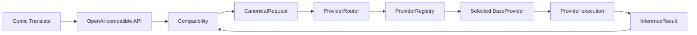
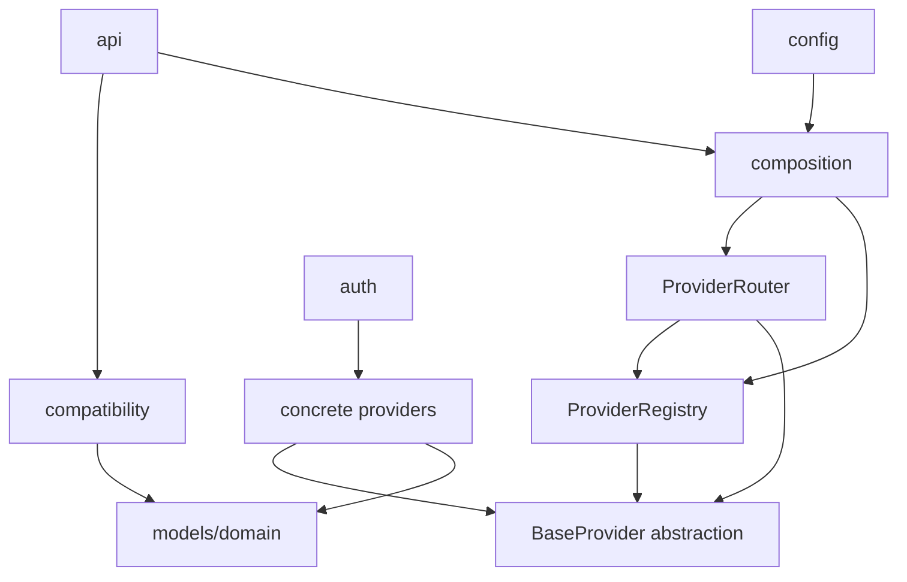

# Provider Contract and Deterministic Routing

## 1. Purpose

This Task 04 architecture document freezes the provider abstraction,
registration boundary, and deterministic routing policy. It is conceptual: it
defines neither Python classes nor runtime/provider/router implementation.



The required path is `CanonicalRequest -> ProviderRouter -> ProviderRegistry -> selected BaseProvider -> provider execution -> InferenceResult`.
The registry lookup may occur during router resolution; it is not an extra provider
call.

## 2. Scope and Classifications

**Frozen decision** means required until an impact-reviewed revision. **Invariant**
means every conforming implementation must preserve it. **Deferred decision** has
an explicit owner and trigger. **Assumption** records a non-evidenced input.
**Open question** records a safe unresolved matter.

In scope: provider interface semantics, identity, registration/configuration,
deterministic dispatch, capability-gate location, and extension seams. Out of
scope: concrete providers, router/registry implementation, catalogs, remote
discovery, exact errors, retries, timeouts, cancellation, OAuth, HTTP endpoints,
tests, and configuration syntax.

## 3. Evidence and Prerequisites

| Input | Accepted evidence | Status |
| --- | --- | --- |
| Task 01 protocol contract | SHA-256 `7f38d5fd91962d50209bc56e68e29c1c6ea44427003c84cada78e3bfd08b7523` | Accepted/frozen |
| Task 02 canonical contracts | SHA-256 `ac71a6ae853dec879f47fe6b403bb04ecf7648eb959b7b8e4c1cda56826edf4b` | Accepted/frozen |
| Task 03 compatibility contract | SHA-256 `30e6d0e6788a4b5fda69225770f332a4119aea6dc3b6d35ac3373e2b981219fb` | Accepted/frozen |
| Repository baseline | `9654b2d5dd07c0fc8e065a92b8e34be28310c97e` | Inspected |
| Project and MVP references | Local project instructions | Binding constraints |
| Upstream SDK/CLI references | Local project reference documents | Versions unpinned; no live probes |

No claim here establishes current upstream model availability, Google headless
multimodal support, or a model-specific capability. Unknown capability is rejected
safely before execution.

## 4. Architectural Boundary

| Component | Owns | Must not own |
| --- | --- | --- |
| `api/` | HTTP validation, dependency resolution, service invocation, response transport | SDK calls, `agy` subprocesses, provider/auth business logic |
| `compatibility/` | Public-to-canonical normalization and completed-result-to-public conversion | Registry lookup, provider selection, SDK/CLI/OAuth knowledge |
| `models/` | Provider-neutral domain contracts | SDK, HTTP, process, credential objects |
| `ProviderRouter` | Resolution, capability gate, dispatch through abstraction | Public parsing, remote discovery, fallback/retry/error envelopes |
| `ProviderRegistry` | Registered provider instance lookup and registered-provider enumeration | Routing policy, remote discovery, auth, execution |
| `providers/` | Canonical-to-upstream conversion, runtime execution, successful result creation | Comic Translate payloads/responses, public routing policy |
| `config/` | Declarative namespace-to-provider binding and provider construction inputs | Provider instances, remote catalog truth, credentials in logs |
| `auth/` | Middleware-managed credential lifecycle and secure storage | Canonical request data, compatibility decisions |
| application composition/lifespan | Long-lived clients, process helpers, registry and router assembly/cleanup | Per-request routing policy or endpoint logic |

Forbidden dependencies, in exactly this architectural substance, are:

```text
compatibility/ -> concrete provider imports
API endpoint -> SDK calls
API endpoint -> agy subprocess calls
```

Also forbidden: `compatibility/` importing concrete provider, SDK, CLI, event, or
process types; providers consuming Comic Translate payloads or constructing public
responses; and Codex CLI as a middleware provider. Codex is a development tool
only, never an inference transport; its credentials and private session files are
never read.

## 5. Dependency Direction



Concrete providers may depend on their official SDK or controlled CLI adapter;
the canonical domain, compatibility, and HTTP endpoints may not. Provider runtime
dependencies/configuration are constructor-injected and explicit. Canonical values
carry no credentials, provider clients, SDK values, subprocess objects, events,
or session state.

## 6. Identity Vocabulary and Grammar

| Term | Meaning | Owner |
| --- | --- | --- |
| public namespace | Client-visible family prefix, initially `openai` or `google` | Public contract/config binding |
| `ProviderId` | Internal registered-provider key, e.g. `openai-siwc` or `google-cli` | Configuration/registry |
| public model ID | Exact client-visible `<namespace>:<slug>` | Compatibility preserves |
| `ModelIdentity.provider_id` | Public namespace from Task 03, not an internal `ProviderId` | Canonical contract |
| `ProviderCapabilities.provider_id` | The same canonical public namespace used by `ModelIdentity.provider_id`; not an internal `ProviderId` | Task 02 canonical contract |
| provider model slug | Opaque upstream `provider_model_id` suffix | Provider receives after routing |
| transport identity | SDK versus CLI or OpenAI auth/runtime path | Configuration/registration |
| auth category | Descriptive capability/configuration metadata, never credentials | Provider/auth |
| display name | Catalog presentation data | Task 05 |

Public grammar remains Task 03's `<namespace>:<provider-model-slug>`, split only
at the first colon. Namespace is `[a-z][a-z0-9_-]*`; it and the slug are nonempty
and have no leading/trailing whitespace. The suffix remains opaque and may contain
colons. `google:gemini-...` and `openai:gpt-...` are public examples, not evidence
that those slugs are presently available.

`ProviderId` is deliberately not exposed as public namespace or stored in either
canonical `provider_id` field. This prevents a
transport/auth choice from becoming a consumer contract and prevents a model slug
from selecting an SDK, CLI, API key, or SIWC path. A selected route keeps the
original complete `ModelIdentity` for result and catalog correlation while the
provider uses only the routed opaque slug.

## 7. BaseProvider Contract

Conceptual contract:

```text
class BaseProvider:
    async list_models() -> list[ModelInfo]
    async infer(request: CanonicalRequest) -> InferenceResult
    capabilities -> ProviderCapabilities
```

| Member | Preconditions | Success | Failure outcome |
| --- | --- | --- | --- |
| `capabilities` | Provider is registered and its static/configured baseline view is available | Returns provider-owned `ProviderCapabilities` whose `provider_id` equals the canonical public namespace served by this registration | Construction/configuration failure follows Task 06; unknown is not upgraded to supported |
| `list_models()` | Provider is registered and discovery/configured listing is permitted | Returns zero or more truthful provider-neutral `ModelInfo` values with namespaced, internally consistent identities | No fabricated model list; registry performs no remote discovery; aggregation/availability/cache semantics are Task 05 |
| `infer(request)` | Request is structurally valid; identity is syntactically normalized; router selected this transport; request has correlation and no credentials; required capability gate passed | Verifies provider applicability, maps canonical values to its protocol, executes, and returns one valid terminal-success `InferenceResult` with original public identity and matching request ID | Never returns partial/failed result; provider/lifecycle error path is Task 06 |

The methods are asynchronous because discovery and inference may perform I/O.
`capabilities` is synchronous only because it must be safe to inspect before
execution; how dynamically obtained evidence is refreshed is Task 05. Instances
receive only explicit injected runtime dependencies (official async clients,
sanitized CLI runner, provider-local configuration, and approved auth service).
They do not fetch a registry from globals or inspect endpoint/Comic Translate data.

An `InferenceResult` is constructed only after terminal success: complete required
text, successful provider terminal state, and preserved correlation/identity.
For example, Responses `response.completed` is required for SIWC; a failed or
premature stream, failed CLI terminal status, or missing text cannot yield a
result. Exact error normalization is deferred, not silently swallowed.

## 8. Provider Registry

**PRD-001 (Frozen decision):** adopt a minimal `ProviderRegistry`.

| Registry responsibility | Explicit non-responsibility |
| --- | --- |
| Register uniquely keyed `ProviderId -> BaseProvider` instances at composition | Parse public IDs |
| Resolve a configured internal `ProviderId` to one instance | Choose namespace binding or auth path |
| Enumerate registered instances for administrative/catalog orchestration | Perform remote discovery itself |
| Fail absent/duplicate/inconsistent registrations deterministically | Retry/fail over, execute inference, store credentials |

Registration is not remote model discovery. A registration proves only that an
instance was assembled; it does not prove credentials, process availability,
remote health, account entitlement, model availability, or capabilities. Provider
existence is router/registry state; model availability is provider/catalog state
owned by Task 05.

## 9. Configuration Binding

**PRD-002 (Frozen decision):** configuration declares one explicit binding from a
public namespace to one internal `ProviderId`; the registry owns the matching
instance. A binding is resolved at application composition, not from request slug.

| Configuration concern | Owner/outcome |
| --- | --- |
| `openai` namespace binding | Exactly one explicit registered OpenAI provider ID |
| `google` namespace binding | Exactly one explicit registered SDK *or* CLI provider ID |
| provider runtime dependencies/configuration | Selected provider constructor/composition |
| duplicate/competing namespace bindings | Invalid configuration; application cannot expose an ambiguous route |
| unregistered configured provider ID | Invalid configuration; route fails before invocation |
| absent namespace binding | Namespace is unavailable; route fails before invocation |

There is no precedence heuristic, subscription-name inference, environment-order
selection, or model-slug-based transport choice. A configuration may assemble both
Google provider instances but it may expose only one `google` binding until a
future approved public namespace/policy revision establishes another unambiguous
selection mechanism.

## 10. ProviderRouter Algorithm

The router consumes an already-normalized `ModelIdentity`; it never reparses raw
public requests or trims/case-folds/reinterprets identity syntax.

1. Accept a valid `CanonicalRequest` and its Task 03-normalized `ModelIdentity`.
2. Resolve the one explicit configuration binding for `model.provider_id` (the
   public namespace).
3. Resolve its internal `ProviderId` through `ProviderRegistry`.
4. Verify registration identity/capability consistency.
5. Consult Task 05-backed availability evidence when an authoritative resolved
    value exists: reject `unavailable`; do not require discovery as a routing
    precondition when availability is not yet evaluated.
6. Determine required canonical capabilities from the request, then reject each
   requirement whose selected provider/model capability is `unsupported` or
   `unknown`.
7. Dispatch exactly once through `BaseProvider.infer(request)`. When model
    availability was not evaluated, the selected provider verifies applicability
    and may fail through the provider/lifecycle error path without fallback.
8. Return only the selected provider's terminal `InferenceResult` to lifecycle
   orchestration; do not replace public identity.

Unknown namespace, missing configuration, competing bindings, missing registry
entry, identity inconsistency, and failed required-capability gate all fail before
provider execution. Syntactically bare or malformed IDs already reject in Task 03
and never reach this algorithm. The router does not default, retry, perform remote
discovery, infer availability, switch providers, or inspect credentials. Known
unavailability and unevaluated availability are distinct: the former rejects at
the Task 05-backed gate; the latter preserves Task 01's no-discovery-precondition
behavior and may reach only the explicitly selected provider.

## 11. Capability Gate

The router gates request requirements against the selected provider's declared
capabilities before upstream execution. Required images, role/instruction
preservation, and other semantic requirements must reject when capability is
`unsupported` **or** `unknown`. It never converts an image request into a text-only
request and does not claim filtered options were applied.

Task 05 owns evidence provenance, freshness, model-specific overrides, MIME/size
constraints, and final merge/availability semantics. Until that evidence exists,
the conservative outcome is refusal rather than upstream guessing. Task 06 owns
the exact exception classes, HTTP mappings, retry/deadline/cancellation behavior,
and redaction.

## 12. OpenAI Routing Policy

`openai:<slug>` resolves only through the configured explicit `openai` binding,
then its registered `ProviderId`. The slug never chooses API key versus SIWC, and
no request value can switch credentials or billing/auth path. The selected OpenAI
provider owns the official SDK, approved credential use, Responses conversion,
SIWC `store=False`/`stream=True`, stream completion, and parameter filtering.

No OpenAI fallback is allowed. An unavailable configured path rejects before any
alternative path is tried. Model availability is not inferred from subscription
labels and is deferred to Task 05 catalog evidence.

## 13. Google Routing Policy

The only current public Google form is `google:<slug>`. Configuration explicitly
binds `google` to either a distinct `AntigravitySdkProvider` registration or a
distinct `AntigravityCliProvider` registration. The model slug never selects the
transport.

| Selected binding | Allowed provider/auth surface | Prohibited behavior |
| --- | --- | --- |
| SDK provider | Official SDK with `GEMINI_API_KEY`, Vertex, or ADC | Read/reuse CLI session/keyring or private Google credentials |
| CLI provider | Official `agy` CLI headless surface; CLI owns login/session/keyring | Extract/reuse OAuth tokens in SDK or invoke private backend APIs |

SDK and CLI may coexist as registered instances without credential/session sharing.
The configuration's one namespace binding determines the selected path. There is
no silent SDK-to-CLI or CLI-to-SDK fallback, even after credential, availability,
or execution failure. Competing Google bindings without an explicit approved policy
are invalid configuration, not an invitation to guess. Headless CLI multimodality
is unverified here, so requests requiring images fail at the gate whenever that
capability is unknown.

## 14. Coexistence and Collision Matrix

| Condition | Router/configuration outcome | Invocation? |
| --- | --- | --- |
| `google` bound to registered SDK; CLI also registered | Route every `google:<slug>` to SDK | SDK only after capability gate |
| `google` bound to registered CLI; SDK also registered | Route every `google:<slug>` to CLI | CLI only after capability gate |
| SDK and CLI expose same slug | Binding wins; duplicate slug does not select transport | Exactly configured provider only |
| Both bind `google` with no explicit approved discriminator | Invalid configuration/collision | No |
| selected binding absent from registry | Configuration/registration failure | No |
| selected path cannot support/verify images | Capability failure | No |
| future `vendorx:<slug>` binding/registration added | Route through its BaseProvider without compatibility changes | Once registered and gated |

## 15. Lifecycle and Resources

Composition/lifespan constructs long-lived official async clients, controlled CLI
runner resources, providers, registry, and router, and cleans them up on shutdown.
Each request uses injected router/provider abstractions and its canonical values.
Provider runtime configuration/dependencies remain provider-local; config contains
declarative binding only. This avoids endpoint globals, per-request client creation,
and accidental provider coupling.

The lifecycle of timeouts, cancellation, process cleanup, stream collection,
retries, circuit state, error mapping, correlation ID generation, and safe logs is
not frozen by this task. Task 06 must preserve this dispatch boundary while defining
those mechanics. Provider/auth lifecycle and administrative routes remain Task 07.

## 16. Routing Scenarios

| ID | Scenario | Required route/outcome | Future assertion |
| --- | --- | --- | --- |
| PRV-001 | Text `openai:gpt-example`, explicit OpenAI binding | One registered OpenAI provider receives original canonical request and slug `gpt-example` | One infer call; public identity unchanged |
| PRV-002 | `google:gemini-example`, SDK selected while CLI registered | SDK provider only | CLI has zero calls; no session sharing |
| PRV-003 | `google:gemini-example`, CLI selected while SDK registered | CLI provider only | SDK has zero calls; no fallback |
| PRV-004 | Same Google slug appears in SDK and CLI catalogs | Explicit binding chooses exactly one | Duplicate slug is never a tie-breaker |
| PRV-005 | Google SDK binding with canonical image request | Dispatch only when selected image capability is supported | Image bytes/order reach SDK adapter unchanged |
| PRV-006 | Google CLI image capability unknown | Reject at capability gate | No subprocess invocation and no text-only success |
| PRV-007 | Provider registered but remote models undiscovered | Provider can route; availability remains catalog/provider concern | No registration-implies-discovery assertion |
| PRV-008 | Add configured `vendorx` BaseProvider | `vendorx:<slug>` routes without compatibility branch | Compatibility tests unchanged except data fixture |
| PRV-009 | OpenAI API-key and SIWC runtime paths both assembled | Explicit OpenAI binding selects one; slug does not decide | Other path has zero calls; filtered SIWC parameters remain provider-local |
| PRV-014 | Valid `other:model` has no configured namespace binding | Reject before provider invocation | Registry/provider infer has zero calls |
| PRV-015 | Configured namespace names an unregistered `ProviderId` | Fail deterministically before capability or inference work | No upstream execution |
| PRV-017 | Selected provider reports required image capability unsupported | Reject before inference | Provider infer has zero calls |
| PRV-018 | Selected provider reports required image capability unknown | Reject conservatively before inference | No SDK call or CLI process |
| PRV-024 | Model is authoritatively unavailable for selected provider | Reject at Task 05-backed availability gate | No provider inference and no fallback |
| PRV-025 | Model availability has not been evaluated | Route only to explicitly selected provider after capability gate | Provider may validate applicability; no discovery prerequisite or alternate-provider call |

## 17. Negative Scenarios

| Case | Failure boundary | Architectural outcome | Future assertion |
| --- | --- | --- | --- |
| Bare `gpt-example` | Task 03 normalization | Syntactic identity rejection; no router fallback | Registry/provider spies have zero calls |
| Malformed `OpenAI:gpt` or whitespace identity | Task 03 normalization | Rejection without case-fold/trim | No binding lookup |
| Valid but unknown `other:model` | Router binding | Unknown namespace failure pre-invocation | Registry/provider infer has zero calls |
| `google:model` with no binding | Router/config | Unavailable namespace failure pre-invocation | No discovery or provider call |
| Binding references unregistered provider | Router/registry | Registration/configuration failure | No upstream execution |
| Two Google bindings compete | Composition/config validation | Invalid configuration, no deterministic route | Application/router is not exposed as ready |
| Automatic SDK-to-CLI fallback | Router/provider boundary | Prohibited even when selected SDK is unavailable or fails | CLI provider has zero calls |
| Automatic CLI-to-SDK fallback | Router/provider boundary | Prohibited even when selected CLI is unavailable or fails | SDK provider has zero calls |
| Google credential/session sharing | Provider/auth boundary | Prohibited; SDK and CLI retain independent supported auth ownership | No CLI keyring/session value reaches SDK and no SDK credential reaches CLI |
| Required capability unsupported | Router capability gate | Explicit capability rejection | No SDK/CLI request/process |
| Required capability unknown | Router capability gate | Same safe rejection | No upstream execution |
| Model authoritatively unavailable | Task 05-backed availability gate | Reject before inference without changing namespace binding | Selected and alternate providers both have zero infer calls |
| Model availability not evaluated | Selected provider applicability boundary | No fabricated availability claim; direct dispatch remains permitted after capability checks | Only selected provider may run; its rejection yields no result or fallback |
| Selected provider fails after dispatch | Provider/lifecycle | No `InferenceResult`; Task 06 error path | No fallback provider call |
| Provider-specific branch/import in compatibility | Dependency boundary | Architecture violation; integration is rejected | Static dependency check finds none |
| SDK call in API endpoint | HTTP/provider boundary | Architecture violation; endpoint remains transport-only | Endpoint tests/mocks observe no SDK call |
| `agy` subprocess in API endpoint | HTTP/provider boundary | Architecture violation; CLI execution remains provider-local | Endpoint tests/mocks observe no process spawn |
| Proposed Codex route | Architecture boundary | Invalid/out of scope | No Codex process or credential access |
| Provider returns raw SDK/HTTP/event/process value | Provider/domain boundary | Invalid success; no canonical result or public response | Result validation rejects upstream object |
| Router returns `ChatCompletionResponse` | Router/compatibility boundary | Invalid dependency direction; router returns canonical result only | Router contract rejects public response type |

## 18. Invariants Registry

| ID | Invariant |
| --- | --- |
| PRI-001 | Every provider consumes only `CanonicalRequest` and yields `InferenceResult` only on terminal success. |
| PRI-002 | Router receives normalized `ModelIdentity`; it never parses raw public requests. |
| PRI-003 | Each public namespace resolves to at most one explicit configured internal `ProviderId`. |
| PRI-004 | A model slug never selects transport, credentials, session, auth category, or billing path. |
| PRI-005 | Missing, invalid, unknown, unregistered, or ambiguous routing rejects before provider invocation. |
| PRI-006 | Registry registration proves instance existence only, never remote model discovery, availability, auth health, or capability evidence. |
| PRI-007 | `unsupported` and `unknown` required capability states both reject before upstream execution. |
| PRI-008 | No fallback, default guessing, load balancing, or retry-to-another-provider occurs in routing. |
| PRI-009 | Google SDK and CLI are separate provider registrations with no credential/session sharing. |
| PRI-010 | `google:<slug>` never silently switches SDK/CLI, including on failure. |
| PRI-011 | `openai:<slug>` never selects API key versus SIWC; explicit binding does. |
| PRI-012 | Compatibility and HTTP endpoints remain free of concrete provider, SDK, CLI, and auth business logic. |
| PRI-013 | Providers preserve public identity/correlation in success results and never construct public Comic Translate responses. |
| PRI-014 | Provider construction receives explicit dependencies; canonical values contain no auth or runtime objects. |
| PRI-015 | Codex CLI is never a middleware inference provider. |
| PRI-016 | Provider existence is registry/router state; model availability is Task 05 provider/catalog state. |
| PRI-017 | Authoritatively unavailable models reject before inference; unevaluated availability neither becomes available nor imposes a discovery prerequisite, and it never permits fallback. |

## 19. Decision Registry

| ID | Decision | Rationale | Prerequisite | Downstream impact | Revisit trigger |
| --- | --- | --- | --- | --- | --- |
| PRD-001 | Use minimal registry | Separates stable instances from routing policy | CDI-001/015 | Task 05 catalogs enumerate providers without coupling | Need for multi-process/plugin composition |
| PRD-002 | Config binds namespace to one ProviderId | Deterministic and auth-safe | CDI-002/003 | Providers may coexist without public changes | Approved new public selector |
| PRD-003 | Public namespace differs from internal ProviderId | Hides transport/auth implementation | Task 03 identity grammar | Prevents slug/auth coupling | Public contract revision |
| PRD-004 | Router performs pre-invocation capability gate | Avoids silent loss/upstream guessing | CDI-005/010/016 | Task 05 supplies evidence rules | Capability model revision |
| PRD-005 | Unknown capability rejects | Safety and capability honesty | CDI-010/016 | Tests require no invocation | Verified capability evidence |
| PRD-006 | Google SDK/CLI are separate registrations | Preserves official auth isolation | Project Google rules | Independent provider tests/config | Official supported shared-session contract |
| PRD-007 | No routing fallback | Prevents silent auth/billing/provider changes | MVP routing scope | Task 06 errors do not retry another provider | Explicit future routing policy |
| PRD-008 | Keep model availability out of registration | Registration cannot evidence remote truth | Task 02 ModelInfo | Task 05 owns catalog/discovery | Task 05 accepted contract |
| PRD-009 | Codex excluded | Required security/architecture boundary | Codex reference | No Codex provider implementation | Explicit future scope approval |
| PRD-010 | Reject evidenced unavailability but permit selected-provider applicability validation when availability is unevaluated | Task 01 requires no prior discovery; truthfulness forbids inventing availability | CT-REQ-005/019; CDI-003/016 | Task 05 supplies authoritative availability states; Task 06 maps provider rejection | Task 05 proves a stricter safe no-discovery policy is required |

## 20. Deferrals Registry

| ID | Deferred decision | Owner | Reason | Revisit trigger |
| --- | --- | --- | --- | --- |
| PRD-D01 | Catalog source, discovery cadence/cache, availability model | Task 05 | Registration is not discovery | Catalog/capability design |
| PRD-D02 | Evidence provenance, model overrides, MIME/size and capability merge | Task 05 | Requires truthful provider evidence | Capability contract acceptance |
| PRD-D03 | Error classes, public envelope/status, timeout, retries, cancellation | Task 06 | Lifecycle ownership | Error/lifecycle design |
| PRD-D04 | Exact binding schema and startup validation mechanics | Implementation/configuration work | This is conceptual-only | Implementation authorization |
| PRD-D05 | OAuth/PKCE, refresh, secure storage/admin endpoints | Task 07 | Auth must not leak into routing | Security/auth design |
| PRD-D06 | Plugin loading and provider performance optimization | Future approved work | No MVP need | Demonstrated scale/extension need |
| PRD-D07 | Public transport selector or extra namespaces | Future approved contract revision | Current `google` contract has one binding | Consumer-compatible proposal |

## 21. Assumptions

| ID | Assumption | Safe consequence |
| --- | --- | --- |
| PRA-001 | Composition can validate static duplicate/absent bindings before accepting requests | Invalid binding prevents ready routing |
| PRA-002 | Providers can report a conservative capability view without exposing credentials | Unknown remains rejection |
| PRA-003 | A future provider can supply a unique namespace and BaseProvider instance | No compatibility-provider branch is needed |

## 22. Open Questions

| ID | Question | Current safe state | Owner |
| --- | --- | --- | --- |
| PRO-001 | What authoritative evidence establishes individual model availability? | Do not infer from registration or plan labels | Task 05 |
| PRO-002 | Which Google CLI headless image path is supported? | Capability stays unknown; reject images | Google review/Task 05 |
| PRO-003 | How are binding errors represented at startup versus request time? | No provider invocation; public mapping deferred | Task 06 |
| PRO-004 | Is a future explicit public transport selector consumer-compatible? | No selector or second binding today | Future contract review |

## 23. Validation Inventory

| ID | Validation target | Expected result |
| --- | --- | --- |
| PRV-010 | BaseProvider contract mock | Provider accepts canonical only and emits terminal completed result only |
| PRV-011 | OpenAI route | Explicit binding maps `openai:<slug>` once, preserving public identity |
| PRV-012 | Google SDK/CLI coexistence | Only configured bound provider executes; no credential sharing |
| PRV-013 | Duplicate Google slug | Binding, not slug, selects provider |
| PRV-014 | Missing/unknown namespace | Failure before registry infer/provider execution |
| PRV-015 | Missing registry provider | Failure before upstream work |
| PRV-016 | Competing namespace bindings | Composition rejects configuration |
| PRV-017 | Image unsupported | Capability failure before execution |
| PRV-018 | Image unknown | Same failure and no subprocess/SDK call |
| PRV-019 | Internal streaming | No result until terminal success; no public partial event |
| PRV-020 | Provider failure | No `InferenceResult` and no fallback |
| PRV-021 | Future provider | New binding/registration does not modify compatibility |
| PRV-022 | Forbidden imports/calls | Compatibility/API cannot reach concrete providers, SDK, or `agy` |
| PRV-023 | Codex boundary | No route, process invocation, or private credential access |
| PRV-024 | Known unavailable model | Authoritative Task 05 evidence rejects before provider inference and never falls back |
| PRV-025 | Unevaluated model availability | No fabricated availability or discovery prerequisite; only selected provider may validate applicability |
| PRV-026 | Task 05 capability overrides | Router consumes resolved model overrides only under Task 05 evidence/freshness rules; unknown required capability still rejects |

## 24. Traceability: Canonical Invariants

| Upstream ID | Handling/result |
| --- | --- |
| CDI-001 | PRD-001 and PRI-001 preserve canonical input/result-only provider contract. |
| CDI-002 | Sections 6 and 10 preserve triple identity and public identity in results. |
| CDI-003 | Task 03 syntax rejects; router rejects unknown/ambiguous route per PRI-005. |
| CDI-004 | Router passes the canonical request unchanged; providers preserve or reject semantics. |
| CDI-005 | Capability gate rejects unsupported/unknown images; no silent text fallback. |
| CDI-006 | Router/registry do not transform text. |
| CDI-007 | Sections 4-5 and PRI-014 prohibit auth/session material in canonical values. |
| CDI-008 | Provider-local SDK/CLI objects are prohibited from domain/compatibility. |
| CDI-009 | Normalization remains Task 03; router only handles valid canonical images. |
| CDI-010 | PRD-004/005 require explicit pre-execution rejection. |
| CDI-011 | Section 7 permits result only after terminal success and nonempty text. |
| CDI-012 | Providers preserve truthful optional usage; routing fabricates none. |
| CDI-013 | Providers normalize result finish state without raw event leakage. |
| CDI-014 | Selected adapter owns parameter mapping/filtering after routing. |
| CDI-015 | Forbidden dependency rules retain provider-agnostic compatibility. |
| CDI-016 | PRI-007 and PRD-005 make unknown a rejection, not permission. |
| CDI-017 | Private provider stream remains internal until completed result. |
| CDI-018 | Router preserves opaque context/request correlation without inspecting it. |

## 25. Traceability: Compatibility Invariants

| Upstream ID | Handling/result |
| --- | --- |
| CCI-001 | Router begins after pure normalization; it never asks compatibility to perform I/O. |
| CCI-002 | Router returns canonical result for the unchanged pure response builder. |
| CCI-003 | Sections 4-5 prohibit concrete provider/SDK/CLI imports in compatibility. |
| CCI-004 | Ordered messages pass as canonical values to selected provider. |
| CCI-005 | Ordered content parts pass unchanged; image gate does not reorder. |
| CCI-006 | Routing does not trim, join, rewrite, or synthesize text. |
| CCI-007 | Task 03 decodes images; Task 04 preserves/rejects but never fetches/drops them. |
| CCI-008 | Auth/session remains outside compatibility and canonical routing. |
| CCI-009 | Public acceptance reaches a separate capability gate, not blind forwarding. |
| CCI-010 | Selected provider maps/filters upstream parameters only after normalization. |
| CCI-011 | Only terminal valid result returns to response construction. |
| CCI-012 | Result text remains exact for the Task 03 builder. |
| CCI-013 | Router preserves original public namespaced model identity. |
| CCI-014 | Raw stream/events remain provider-local and cannot become public success. |
| CCI-015 | Router/registry do not invent usage or label units. |
| CCI-016 | Task 03 closed-field rejection remains before routing. |
| CCI-017 | Public complete response/private stream split remains unchanged. |
| CCI-018 | Request/result correlation remains opaque and credential-free. |

## 26. Traceability: Compatibility Decisions and Deferrals

| ID | Handling/result |
| --- | --- |
| CCD-001 | Consumed: router uses the already first-colon parsed identity and does not reparse. |
| CCD-002 | Resolved: registry/model/transport validation is Sections 8-14 of this task. |
| CCD-009 | Preserved: auth/transport values remain excluded from canonical routing. |
| CCD-010 | Preserved: router neither generates response IDs nor reads clocks. |
| CCD-014 | Preserved: public streaming stays unsupported; selected provider may stream privately. |
| CCD-015 | Preserved: adapter owns Responses conversion, filtering, and event collection. |
| CCD-016 | Preserved: rejection semantics only; Task 06 maps errors/envelopes. |
| CCD-D01 | Resolved by this document: registry, routing collision, and Google transport policy. |
| CCD-D02 | Deferred to Task 05 as PRD-D01/D02. |
| CCD-D03 | Deferred to Task 06 as PRD-D03. |
| CCD-D04 | Deferred to Task 06 as PRD-D03. |
| CCD-D05 | Deferred to Task 07 as PRD-D05. |
| CCD-D06 | Deferred to implementation as PRD-D04. |
| CCD-D08 | Preserved: project.md priority keeps provider conversion outside compatibility; instruction wording needs separate maintenance. |

## 27. Downstream Implications

Task 05 must define catalog/discovery/availability and capability evidence without
making registration itself availability proof. Task 06 must define error/lifecycle
mechanics without adding fallback or allowing failed execution to create a result.
Task 07 must keep credentials and admin/auth lifecycle outside canonical/router
data, preserve Google SDK/CLI isolation, and default local binding to `127.0.0.1`.
Implementation must inject dependencies at composition, use provider abstractions
at the router boundary, and add focused registry/router contract tests from PRV.

## 28. Security Impact

The contract prevents credential/session selection by untrusted model slugs,
prevents SDK/CLI cross-fallback, and refuses unknown multimodal capability before
execution. It does not authorize private credential reading, undocumented backend
calls, secret logging, public binding, or Codex inference. No secrets belong in
config examples, canonical values, diagnostics, fixtures, or results.

## 29. Review State

This is the primary Architecture & Security design artifact, not its own
independent approval. A focused, read-only Google / Antigravity review returned
`APPROVE` with no blocking findings. It confirmed separate SDK/CLI registrations,
strict credential/session ownership, explicit configuration-based transport
selection, opaque model slugs, no implicit fallback, and conservative rejection
of unknown required capability.

The Google review recorded two downstream handoffs rather than Task 04 defects:
Task 05 must retain `unknown` for `agy` headless multimodal support until verified
evidence exists, and implementation must index the registry by internal
`ProviderId` while preserving canonical namespace `google` in `ModelIdentity` and
`ProviderCapabilities`. Its optional exact configuration example remains properly
deferred by PRD-D04. No live probe, keyring/auth inspection, or upstream capability
claim was performed; SDK and CLI versions remain unpinned.

A fresh independent Architecture & Security review first returned `APPROVE WITH
REQUIRED CHANGES` with no blocking or security findings. It required an explicit
unknown-versus-unavailable-model outcome. Sections 10, 16-19, and 23 resolved that
finding through PRD-010, PRI-017, and PRV-024 through PRV-026 while preserving
Task 01's no-discovery precondition. A new independent verification then returned
`APPROVE` with no blocking, important, or optional contract findings. It confirmed
canonical identity, deterministic routing, capability-versus-availability
separation, Google transport isolation, dependency direction, security, and Task
05/06 ownership. The user explicitly approved Task 04 on 2026-10-13; the artifact
is completed for commit.

## 30. Task 04 Freeze

**Frozen conceptual scope only:** BaseProvider semantics, ProviderRegistry minimal
role, explicit namespace-to-provider binding, router algorithm, conservative
capability gate, OpenAI/Google routing separation, no fallback, and forbidden
dependencies. This does not freeze implementation classes, model catalogs,
upstream availability, configuration syntax, error mechanics, auth lifecycle, or
unverified upstream capability.

## 31. Completion Evidence

The sole Task 04 architecture deliverable is this document. Execution bookkeeping
also updates the Task 04 task record and Wave index; no other artifact is authorized.
The document was authored against the accepted local prerequisite hashes and
repository baseline recorded above. Its validation is document-level:
link/term/scope inspection, all required scenarios and traceability inventories,
and a no-index whitespace check. Ruff, mypy/pyright, and pytest are not applicable
because no executable source or tests are authorized by this task.